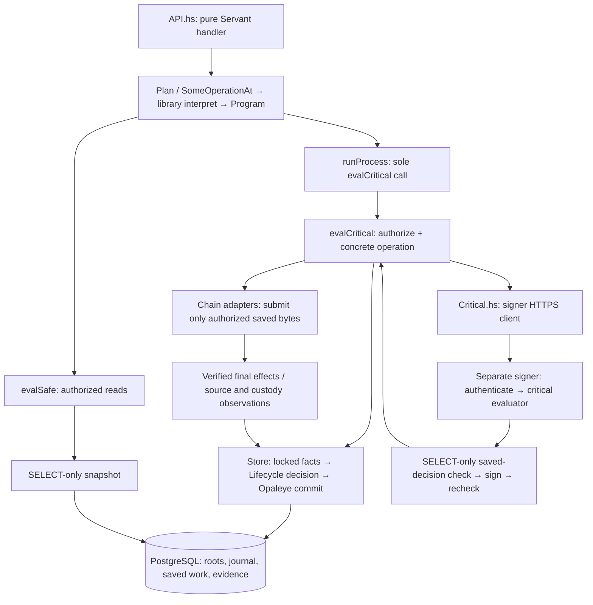

# Architecture and financial contracts

The source map is in the [audit path](#audit-path) below. This guide defines the
boundaries a reviewer must trace; [release review](RELEASE-REVIEW.md) records what
is actually verified. There is one Servant HTTP/worker process and one dedicated
signer. PostgreSQL, the native daemon, Solana RPC and restic are dependencies.
The Haskell browser is compiled by GHC JavaScript; Rust is confined to SDK FFI.
Public HTTPS terminates directly in the worker's WarpTLS listener; no reverse-proxy
process is required. Optional certificate/key environment variables enable public
IPv4 TLS; their absence preserves loopback HTTP, and partial configuration refuses
startup. Constant-space global request/order admission budgets precede the existing
body/concurrency controls in TLS mode. These controls grant no DSL authority and
are not a separate process isolation boundary. The signer remains separate.

## Start the audit here

Follow one order through this path, then repeat it for refund and earned funding.
The [source map](#audit-path), authoritative-fact table and invariant
index below identify the concrete implementation and its checks. Historical test
results belong in RELEASE-REVIEW; they are not assumptions that new code is safe.



No database transaction spans signing, chain RPC or backup upload. A pure decision
does not carry execution authority; the closed Store leaf obtains its facts under
the database lock. The signer has no database writer and cannot broadcast. Saved
bytes must be durably recorded and covered before the worker can submit them.

## Requests, dictionaries and evaluators

The user's exact [Main.hs](reference/Main.hs) is preserved outside production
builds, SHA-256 `f1d0777a8d2fddd62881aa5d85f518884c9d4efb451480f1520a677ab2319ea2`.
Read it before changing the operation boundary. The production grammar corrects
its permissive/incomplete sketch types while retaining its constrained design:

```haskell
-- A selector sees only its named capability, even though the hidden command's
-- canonical dictionary contains all capabilities for its caller.
operator @'[OperatorService] (\cap -> pauseService cap "review")
workerRequest @'[WorkerSigning] (\cap -> signPreparedPayment cap payment)
```

`Command caller severity result` is the closed payload GADT. The argument-free
`Compile` selector carries combined compilation and execution constraints.
`Operation.interpret` proves the complete payload type with `eqT`/`Refl`, then
branches into the six programs. Operator and worker branches run the library's
`Restrict` pipeline followed by `withCapabilities`: the rank-n selector receives
only its explicitly selected capability dictionaries. Its selected list must be a
subset of that caller's closed `DomainCaps`, so operator requests cannot select
worker capabilities. Customer and signer leaves retain their small explicit GADTs.
`eqT` compares payload types, including caller, severity and result; it does not
compare dictionary values or authorize effects.

`Control.Operation.Severity` owns `Safe`, `Critical` and the opaque
`SomeOperationAt program caller severity result` existential. Its four nominal
indices prevent coercing a customer into a signer, a safe operation into a critical
one, or changing its program/result. The bridge has no `Pending`/request wrapper.
`PreparationCaps` still contains `CompileOperation` and the applicable worker or
operator capability list. Their class methods select allowed programs without IO,
keys or database connections.

`pending` passes `operationDSL` directly to the library's `prepareOperation`.
That method requires only `CompileOperation` and returns `OperationDSL`, proving
that its selected output is exactly `Program caller severity result`. Compilation
and domain capabilities remain independently restrictable. Packing selects the
DSL but does not interpret it. `checkedOperation` delegates to `resolveOperation`,
which runs the instance above. No evaluation environment enters these steps.

Capability visibility is not irreversible revocation or a sandbox: the library
retains the canonical dictionaries for interpretation. Severity is classification,
not financial authorization; concrete evaluators still enforce that policy.

The compiler emits the closed `Program` effect grammar. Its six constructors retain
the precise execution constraints and leaf result types. This separates the
library's pure compilation DSL from concrete IO without copying business rules.
`Plan caller a` contains a safe or critical pending operation. Customer handlers
have `ServerT CustomerAPI (Plan 'Customer)`; signer handlers use
`ServerT SigningAPI (SomeOperationAt Program 'Signer 'Critical)`. Servant's hoist compiles/evaluates
the existential; only the concrete result is serialized. Handlers select constrained methods; they cannot supply an IO callback. Customer order creation confers no operator or signer authority.
Cabal's customer-api component exposes only the customer facade, with no runtime,
store or chain dependency. Review component boundaries as well as types.

All six `Execution` instances live in `Critical.hs`, beside the safe and critical
evaluators. Their methods consume the compiled `Program` directly, with no
`command`/`compileOperation` forwarding or reconstruction of the original request.
Their methods implement concrete effects except local signer execution,
which belongs directly to the gated critical evaluator. There is no
`Interpreter` class or arbitrary environment/program execution instance. The core declares an opaque `Evaluation` data family; only `Critical.hs`
defines its two concrete severity instances and can construct them. Safe resources
are a reader and public configuration. Critical resources are either worker
resources or signer resources, which contain no writer. IO is fixed; polymorphism
in the result preserves the result selected by the operation's GADT or method.

The former broad `OperatorWrite` and `WorkerOperations` classes are split into
these independently selectable capabilities:

| Caller | Capability groups |
| --- | --- |
| Operator | `OperatorService`, `OperatorRepair`, `OperatorNative`, `OperatorSource`, `OperatorTreasury` |
| Worker | `WorkerBackup`, `WorkerObservation`, `WorkerRecovery`, `WorkerPreparation`, `WorkerSigning`, `WorkerQueue`, `WorkerBroadcast`, `WorkerCycle` |

Each method returns a typed `Program`. Their `Action` data-family instances remain
private to `Critical.hs`: only that module constructs the concrete IO actions,
attaches observation-mode permission and supplies the resource environment. The
operator/worker `Execution` instances inspect that permission and run the saved
action. Existing recovery/observation worker access and operator pause permissions
are unchanged. `-Werror=missing-methods` checks the concrete capability instances.
Independent operator commands use narrow selectors; they are not artificially
chained into a workflow. Only genuinely ordered work uses Flow.

The worker's bounded payout sequence uses `Control.Operation.Flow` from the pinned
operation-capabilities 0.1.3.0. **Build the whole workflow inside `interpret`, after
`eqT`/`Refl`; evaluate it separately.** `PayoutWorkflow` in `Operation/Internal.hs`
implements that boundary: its `CompilePayoutWorkflow` constructor carries
`PayoutCapabilities` (the union of its seven required worker groups), its payload
equality proof precedes the `F.do`, and its outcome
is the pure typed Flow. The wrapper declares no additional preparation capabilities.
`payoutFlow` only requests interpretation and returns `Nothing` on mismatch. The
worker rejects mismatch, then runs the resulting workflow under the held critical
gate. Runtime-dependent branches remain deferred continuations of the compiled Flow.

The flow inspects saved attempts, prepares/backs up/signs a new payment or selects
its saved transaction, then queues/backs up and broadcasts. Each
`PayoutInstruction` requires its own capability: observation, preparation plus
backup, signing, recovery, queue plus backup, or broadcast. Those dictionaries
restrict stage construction. Concrete leaf interpretation still chooses the
fixed, private implementations; it does not execute caller-supplied dictionaries.
Its `evalWorker @'[SelectedCapability]` calls go through the same restricted request
path described above. Payment/transaction identifiers travel through distinct
`PreparedPayout`, `SignedPayout` and `QueuedPayout` states. These record sequencing,
not financial authority. `payoutOperation` separately packs each private leaf
`PayoutCommand` into `SomeOperationAt`. Its `interpret` in `Critical.hs` proves the
complete capability-carrier/input/output/result payload type, then selects a
deferred `WorkerEffect`.
Private `evalWorkerRequest` executes that action inside the already-held gate;
existing ledger checks and `evalWorker` dispatch remain. No new API, signer path,
database operation or retry policy is introduced.

Compile checks reject hidden signing, broadcast, treasury and replacement methods
on actual request selectors, cross-caller capability selection, and preparation
without backup capability. The flow contract checks mismatched whole-workflow
payload rejection, then resolves
and traces the actual compiled Flow and its leaf operations with an independent
oracle. That verifies compilation and sequencing, not execution of the concrete
closures. Exceptions, including cancellation and unknown signing or broadcast
outcomes, stop the continuation. Completed effects are not rolled back; restart
recovery uses the ledger and exact saved bytes. Never replay the Flow as an automatic
retry. `IndexedRequest` is not added as a second registry: the current typed selectors
already retain the required capability dictionaries.

Both evaluators use the private `Executable` view to recover a payload-free
`ExecutionProof` of the constructor's combined constraints. Authorization and
evaluation receive the same compiled program; worker/operator selectors are not
run again. Safe evaluation calls `authorizeOperation` then `evaluateOperation`.
Critical evaluation authorizes, then matches the four `SigningDSL`
leaves in a signer context, keeping each read/sign/recheck or checkpoint sequence
inside its held gate; all other cases call `evaluateOperation`. The signer instance's
method constructs only the worker's HTTPS client and refuses local signer execution.
There is no signer `run` helper or method that executes keys outside `evalCritical`.
`runProcess`
owns the concrete worker or signer service lifetime. After validating that mode's
resources it allocates one gate and defines the sole `evalCritical` call site.
It then runs HTTP/worker/control or signer HTTPS with that local dispatch. It does
not return an evaluator or hand one to a caller-supplied continuation. The CLI
normalizes both startup modes before its single `runProcess` call; its resource
bracket passes only resource data, never evaluators. Each process retains its own
gate and resource context. Worker entry refuses
signer requests; signer entry refuses customer/operator/worker requests. Internal
worker and signer instructions pass `checkedOperation` and invoke the concrete method
inside the already-held gate, without reacquiring it. Only that internal signer
method constructs the HTTPS client; the signer context executes local signing.

The bounded `checkpoint CONFIG` worker lifetime acquires the same writer/advisory
lock and host fence, but starts no HTTP listener, control socket or observer loop.
It dispatches only `checkpointForUpgrade` through the existing critical call site.
That closed operation requires a paused ledger and obtains a fresh verified custody
receipt even when prior backup coverage is current. Receipt acknowledgement must
complete before the command emits success. The signer remains a separate process;
no signing keys or additional signer client are introduced. Guided upgrade
orchestration prevents worker restart between checkpoint exit and upgrade using
root-owned persistent systemd conditions. `Upgrade.withLifecycle` holds a global
setup lock and journals candidate/current release hashes, identity, configuration,
checkpoint receipt and validated fence evidence. It stages the candidate before
running the closed checkpoint command as the worker identity. It never queries the
database or constructs a signer client. After publication it stops any previously
resumed worker again, validates a nondecreasing fence and uses ordinary startup and
checked resume against current chain state. Immutable phase records remain after
completion. Same-schema upgrades reuse the database; schema changes refuse.
For older installed signers, the same-schema candidate is staged as a temporary
systemd executable override before checkpointing. The worker stays persistently
blocked; signer exit is verified before changing the override. The journal binds
its exact bytes, candidate path and configuration hash. The managed native helper
is pinned to that candidate, and existing helper instances are stopped before unit
replacement. Merged systemd command/environment checks precede signer restart.
A saved checkpoint skips the transitional restart. Publication verifies the candidate
before removing only the journal-owned override and checking the normal service.
End-to-end interruption and version-transition acceptance remains required.

`Signer.hs` owns Servant routes, authentication and TLS transport. Signer startup
and key operations live in `Critical.hs`. The dedicated signer independently
authenticates requests and holds its gate across validation, signing and the
second durable-decision read. Sharing evaluator code does not merge processes,
credentials or gates. Safe reads remain concurrent. No database transaction spans
RPC, signing or remote backup. The workflow instances are intentionally orphan
instances: final-program coherence checks must import `Bridge.Critical`, rather
than testing the grammar component alone.

Do not add arbitrary IO/SQL operations, severity casts, incoherent authorization
instances or generic connection callbacks. The reference's weekly limit/multisig
comments are design notes, not implemented guarantees.

## Signer authority and output identity

Only the critical interpreter constructs the generated Servant `ClientM`. The
private API binds loopback HTTPS and authenticates with a protected token. The
worker trusts the configured certificate with hostname validation; transport has
bounded bodies/timeouts and no proxy, redirects or automatic retries. The signer
uses SELECT-only ledger access, validates saved authorization and exact effects
before/after signing, and never broadcasts.

| POST path | Leaf operation | Unique result constructor |
| --- | --- | --- |
| `/sign-preparation` | `SignPrepared` | `PreparedResult` |
| `/sign-replacement` | `SignReplacement` | `ReplacementResult` |
| `/draft-replacement` | `DraftReplacement` | `DraftResult` |
| `/checkpoint-custody` | `CheckpointCustody` | `CheckpointResult` |

`data family Result severity op` is injective in both indices. Leaf GADTs fix the
result before the command family is hidden existentially. Four disjoint JSON fields
and strict decoders preserve response identity. Retries may repeat the same saved
result; uniqueness means non-interchangeable constructor paths, not fresh values.

[test/formal/SignerPaths.tla](../src/test/formal/SignerPaths.tla) defines an explicit
`OutputStates` set and checks unique generating paths, route/output alignment,
authentication/refusal and critical-dispatch requirements. The two-request TLC
model reached 54,289 distinct states without violations; deliberate wrong-output,
reused-constructor, auth/dispatch-bypass and observer-dispatch mutations were rejected.
It includes an inductive argument, not a TLAPS-checked unbounded theorem or automatic
Haskell refinement proof. It does not prove cryptography, custody or OS isolation.
Ordinary constructors/JSON remain constructible by trusted code. A separate client
with valid signer credentials can call HTTPS; it is still subject to signer checks.

Custody keys and full native credentials must be inaccessible to the worker through
OS permissions and node RPC restrictions. Deny signing, key export, wallet unlock
and wallet lock; `walletprocesspsbt` is signing-capable even when a caller requests
an unsigned result. Replacement drafting therefore belongs at the signer. Process
separation alone is insufficient while a full credential remains readable.

Optional `nativeUnlockFile` contains 1–1024 exact UTF-8 bytes, no NUL or line ending,
in a protected mode-0600 regular file. Unlock/sign/relock occurs inside the signer
gate; cleanup also follows an uncertain unlock reply. A 120-second daemon lease
bounds exposure after process loss or failed relocking. The worker can allocate
cached descriptor addresses while locked; keypool exhaustion remains a node refusal.

## Database and financial authority

Every application row read/write, diagnostic, privilege check and test fixture
uses Opaleye in a specific closed operation. Connections, transaction control and
fixed schema DDL are infrastructure. No handler gets a connection or generic
query evaluator. Safe evaluation and the signer use distinct SELECT-only roles,
including SELECT on sequences without USAGE/UPDATE. Startup checks inherited and
catalog privileges, schema creation and elevated role flags.

The writer owns a deployment advisory lock and an independent monotonic host fence.
Ledger actions explicitly use READ COMMITTED / READ WRITE and lock the deployment
row before reading decision facts; safe/signing reads use READ ONLY / REPEATABLE
READ snapshots. The fence advances before commit;
stale/wrong-identity/retired state is refused. Unexpected database failures fence the
connection; policy failures permit reuse only after successful rollback. Startup
pauses intake. Runtime reads/writes and backup/restore accept only schema 23.
Fresh setup installs `src/schema.sql` in one transaction with its installation
receipt. The closed initializer refuses residual financial rows and records the
identity with intake paused. Existing matching schema-23 ledgers are preserved;
older or unknown versions are rejected. Worker privileges remain DML only.

Amounts are canonical base-unit decimal strings. Both conversion assets have eight
decimals; arithmetic uses Integer with bounded persisted values. New fee is
`ceiling(gross * 100 / 10000)` and net is gross minus fee. Reject nonpositive net.
Save quote, direction, destinations, deadlines, confirmation/finality, cost limits
and deployment fingerprint immutably. Network fees/rent never reduce quoted net.

Each append-only event balances independently by asset. Principal protects customer
receipts; float funds payouts; earned holds settled revenue; operating pays costs;
unallocated, backing and LP balances remain protected. External is a counter-entry,
not capital. Never infer spendable float from a wallet balance. Conversion, full
refund and earned-fee withdrawal share a payment engine with explicit funding types;
withdrawals never fabricate customer orders or deposits.

Admission reserves conversion and alternate refund costs, including rent, within
available allocations and rolling 86,400-second budgets. Immutable cost times and a
monotonic durable clock prevent clock rollback from resetting budgets. Expiry
releases only provisional holds. Funded/signed work retains its protection. Treasury
allocation requires a finalized eligible unbound receipt, an exact split, paused
service, ownership attestation and matching custody; SOL only funds operating.

Initial self-funded ATA accounting is a private `initializeOperating` operator
leaf. It verifies exact signed setup bytes and matching finalized JSON effects on
two independent providers before `InitializeSolanaOperating` commits under the
writer lock. The immutable proof type has no exported constructor or record-update
fields. The store rechecks revision, fresh scan heads, original history boundaries,
receipt and observation identity, cost caps, zero prior financial activity and exact
unallocated balances. Allocation and observed setup-cost classification commit or
roll back together. It creates no signing or broadcast authority and leaves custody
uncertified and paused. Exact committed receipt/signature/attestation replay is a
closed read before any live RPC prerequisite; ordinary treasury and reconciliation
checks are unchanged. See `initial_funding` and `initial_customer` PostgreSQL modes.

## Customer and payment lifecycle

A random saved 32-byte capability and idempotency key precede order creation.
`Authorization: Bearer <64 lowercase hex characters>` grants access; only a
domain-separated hash is stored. Replaying identical immutable input recovers the
order; changed input conflicts. Order IDs, QR codes, memos and payment links alone
grant neither access nor deposit credit.

Wrapping binds an external Solana recipient and native refund address. Unwrapping
binds a native recipient and Solana Pay reference, then verifies the actual sender
for refunds. Native admission checks the real checkpoint/network, supported scripts,
ownership, dust and fee policy. Solana admission checks genesis, classic SPL program,
mint/ATA identity, initialized mint layout, decimals, absent freeze authority,
ownership, balances and fee/rent limits. The shared mint parser also validates
issuance authority and bounded supply; configured providers must agree on authority,
while differing supply snapshots are allowed. This does not pin an issuer-approved
authority. Unsupported
extensions, delegates, close authorities and account forms are refused. Simulation
success does not guarantee later execution.

All three profiles use this same order/payment path. `CanonicalBeta` binds the
ECX checkpoint and canonical mint to Solana Mainnet genesis, requires an independent
HTTPS verifier and requires backup coverage in the deployment configuration.
The CLI validates that configuration before creating reader/writer/signer resources;
`runProcess` checks their chain and customer identity alignment. Mainnet has no
separate evaluator or manual payout shortcut. Observation mode still refuses paying
operations; paying mode starts paused and must pass operator resume checks.

Native provisioning saves a unique claim before allocating an address. Only the
claim creator allocates; retries recover the exact labeled owned, solvable,
non-change P2WPKH address. Ambiguous allocation cannot silently allocate another.
Instruction exposure requires unexpired, unpaused intake, retained holds, fresh
custody/scans and required backup. Recovery never extends saved deadlines.

1. Observe the exact qualifying deposit; preserve liabilities for partial, late,
   additional, unknown or ambiguous receipts and route them to review/refund.
2. Save a funded outgoing intent and exact preparation generation/draft. Native
   locks may cover only saved inputs; independently check prevouts, change and fees.
3. Obtain required backup coverage, sign the saved decision, independently validate
   the result and persist its exact bytes. A lost signing reply grants no send authority.
4. Record broadcast intent and sequence, cover it, then recheck source, readiness,
   costs and Solana validity. Submit only saved authorized bytes.
5. Independently observe actual confirmed/finalized effects and atomically settle
   principal, fees, operating costs and reservations. A signature or submission
   acknowledgement is not settlement. One economic payment has one settled winner.

Solana preparations retain exact messages, references, blockhash/validity and cost
limits; Haskell checks SDK bytes and Ed25519 signatures. Failed finalized transactions
book only verified costs. Additional refunds never overwrite a completed conversion's
payout link. Old unfinished records without saved executable policy require review.

## Observation and recovery

Observers atomically commit pages with their previous cursor. Native, custody-token
and SOL histories retain immutable origins. Unknown outflows are quarantined;
signed/unseen bytes do not explain spent funds. Errors preserve cursors.
An unavailable Solana verifier refuses the whole token scan, preserving existing
receipt eligibility; contradictory finalized evidence still enters review. New
receipts wait for successful verification, and scanner failure pauses intake.
Custody compares actual balances with journal balances and only verified observed unbooked
effects. A revision fences the snapshot; financial changes invalidate it. First
intake/exposure requires scans/custody no older than 60 seconds. Checks never resume
the service by themselves. Source updates and slow plan RPC can invalidate readiness;
refresh it before preparation, signing, queuing and send authorization. Keep the
final transaction-acceptance/blockhash check after that refresh. Refresh is bounded;
if custody reads age the scans, recheck and refresh again without extending their
60-second validity. If custody discovers history ahead of a saved cursor, its
closed ledger operation also marks the affected scan stale without advancing the
last successful scan time. The next readiness refresh must observe that history;
it cannot repeatedly certify the same old cursor. Native advancement invalidates
the native scan; a Solana history mismatch invalidates both Solana streams.
A completed scan still requires fresh custody reconciliation before authorization.
The paired Solana scan shares one identity check within that invocation; both
batches retain the timestamp captured before identity verification. Preparation or
identity failure marks both streams failed. Standalone scans still verify identity.
Reconciliation independently checks both genesis hashes, reads mint/token/owner
accounts together at finalized commitment with the saved minimum slot, then checks
both distinct history heads on each provider. No evidence survives into another cycle.
For an idle cycle without pending work, this reduces primary calls from 16 to 11
and verifier calls from 9 to 6. Transfers and recovery add calls; these counts are
not a quota guarantee. ChainCheck covers invocation isolation and failure paths;
StoreCheck covers the exact account/head requests, changed mint policy, stale slots,
provider disagreement and preparation failure against PostgreSQL.
Recovering native receipts are reread beyond the incremental
cursor so their deposit state and matching evidence are committed together.

Native history uses a fully validated temporary RPC capture, replayed one entry at
a time with only transaction ID, confirmations and block hash retained. Other
fields, including unbounded wallet conflict arrays, are traversed for valid JSON
without building aggregate Values. Each `CommitNativePage` atomically saves classified receipts/evidence and
unhealthy scan status while retaining the original checkpoint. This status blocks
readiness without changing the operator's pause state; genuine scanner failures
and chain reviews still pause. Only after replay and the complete recovery-source
sweep does an empty `CommitScan` advance coverage, using the original scan-start
time. Restart recaptures from the unchanged real checkpoint and replays durable
pages idempotently. No offset into a new RPC response is treated as coverage.
Recovery candidates use immutable deposit-ID keyset pages of 128 rows, advancing
past examined sources even when they remain pending. Only adjacent duplicate
transaction IDs are coalesced; nonadjacent duplicates are reread and committed
idempotently. Incoming/source `gettransaction` uses the same private capture
transport with a projected token reader. It discards raw hex, decoded inputs and
unused metadata before constructing aggregate Values. Output/detail ceilings
(111,111/222,222) and the aggregate 1,000,000-byte script budget derive from the
pinned ECX stripped-transaction weight rule; they are not customer size policy.
Individual strings are still materialized by Aeson, and local wallet metadata has
no established scalar bound. This is not a constant-memory decoder for every input.

Custody validates history in batches of at most 128 parsed entries through the
closed `CheckNativeCustodyHistory` Opaleye read. Each snapshot checks every entry
in history order, including duplicates; missing, reviewed and changed evidence
remain distinct failures. Pending entries are checked before reporting a later
parse/cursor failure. Final revision fences reject changes between snapshots.
Expired scans refuse intake without adding or clearing an operator pause; they
must be refreshed. Original scan timestamps and the 60-second limit remain.

Receipt writes split into at most 1,000 deposits per page; only the final page
publishes that transaction's complete receipt commitment. Every partial page keeps
scan health unavailable. Treasury verifies the commitment against paged durable
receipts, unchanged anchors and non-regressing depths; focused source refresh can
advance a sibling's confirmations without invalidating that proof.

Wallet conflicts have no consensus count bound. Projection validates each hash and
retains only their count, while `rpcCaptureHash` binds the complete response bytes.
Source recovery compares both projected observations, including that hash, so a
change in omitted fields still refuses the transition. Byte-equivalent captures
are required; different JSON formatting also refuses and requires a fresh check.
This hash is distinct from historical `rpcPayloadHash` of Aeson-reencoded results.
Authored native payout/family validation retains the full ordinary bounded RPC and
its signing restrictions. Long-scan freshness and live acceptance remain open.

Paused recovery can record observed effects and recover owned input locks, but
cannot prepare/broadcast new payments. Foreign locks stay untouched. Cancellation
journals exact cleanup, excludes recorded signatures and retains liabilities;
unknown cleanup stays pending. Never unlock an empty input list. Generation count
is bounded at eight, and old-generation callbacks cannot change newer work.

Solana retry requires every configured provider to establish finalized height past
saved validity, invalid blockhash, absent transaction/status and complete histories
to immutable origins. Truncated/unavailable history is not proof. Preserve bytes and
principal, then require a separate paused immutable approval for a new generation.
Amount, recipient and reference remain fixed; costs are reserved again.

Native replacement retains inputs, sequence, version/locktime, recipient/amount,
change address and fee ceiling; only change decreases to fund the added fee. Keep
all bounded family members and immutable decisions observable. Foreign spenders,
conflicting drafts and ambiguous winners require review. Observe the sole actual
winner; a proven later winner change adjusts only costs, never principal again.
Singleton and replacement payouts share the same verified family reader for
observation, custody effects and input-lock recovery. A retained zero-confirmation
wallet record alone does not establish an active spend; absence requires stable
chain/wallet views and unchanged unspent inputs. For a retained non-abandoned,
non-conflicted inactive transaction, custody adds back the verified shared inputs
excluded by Core's wallet balance, once per family. This reporting correction is
separate from economic in-flight effects; missing or abandoned records add nothing.
It requires explicit untrusted wallet records, disabled address-reuse avoidance,
and zero wallet pending credit: even unrelated unconfirmed pending balance defers
normalization, so asynchronous wallet mempool updates cannot double-count change. Family
classification and balance anchors are rechecked together; unexplained mismatches,
overlapping families and changing or unavailable evidence still refuse readiness.
Rebroadcast requires explicit saved approval, current source proof and backup and
uses identical bytes. It does not grant replacement authority.

Source loss retains obligations, holds and attempts. Corroborated native loss books
a deficit; unavailable data is not loss. Return reverses it once and restores
confirmation review. Separate source-restoration or covered-source approval binds
the exact suspended work, latest decision, current custody and required coverage.
Full loss coverage consumes only genuinely free native float/earned capital, never
principal, operating, backing or LP. Return restores the original split once.
Unresolved reviews, deficits or missing policy prevent resume.

Read-only RPC retries use a fixed bounded allowlist. Solana history-storage error
`-32019` retries only the three history methods within the same two-retry budget
as rate limits and closed connections; exhaustion preserves the error. Wallet mutations, sends and
unknown outcomes are not automatically retried. Fixtures are not substitutes for
real protocol/network acceptance.

The shared RPC manager spaces HTTPS admissions by normalized hostname using a
monotonic clock and a cancellation-safe per-host gate. It runs once per actual
HTTP request, including each allowed retry. Waiting for one provider does not block
another. Worker and signer budgets are separate; deployment must keep their sum
and other consumers within provider quotas. Pacing neither authorizes a payment nor
extends its saved deadlines, custody freshness, backup or blockhash checks.

The closed ATA setup evaluator runs only before installation. `Token.Network`
checks the complete unsigned message, fee/rent limits and simulation before signing,
then exclusively saves the signed attempt before submission. A restart submits only
the same saved bytes after inspecting its signature/status. The live bridge signer
remains separate and has no mint, burn or liquidity-pool operation.
`Bridge.AdminStatus` classifies exact saved transaction outcomes for setup and initial
funding accounting. Existing ATA attempt lineage and successor-refusal checks remain;
this repository contains no standalone token recovery writer or offline signing CLI.

## Shared protocol mechanics

Share parsing mechanics while retaining each caller's authorization rules:

| Repeated responsibility | Shared owner / retained difference |
| --- | --- |
| Canonical decimal strings in bridge and ATA setup | Domain's bounded natural parser; bridge narrows to signed Int64 and ATA rent to Word64. Positive-only fields reject zero separately. Native scientific coin parsing remains distinct. |
| Classic SPL account JSON in bridge and ATA setup | Solana parser returns typed owner/balance/mint once; custody additionally binds expected identities and its ledger range. Classic mint policy checks remain. |
| Base64 account/message decoding | SolanaMessage bounds encoded text before decoding and decoded bytes afterward; callers retain exact account size/layout, field set and error category. Transaction signer/instruction/account limits remain separate. |
| HTTPS session/genesis setup and hostname normalization | RPC shares mechanics and closes each administration session; each caller supplies its exact genesis and existing errors. Independent providers, mutable reads and uncertainty semantics remain explicit. No extra retries or permanent identity cache. |
| Saved/SDK/HTTP representations | Keep original bytes at persistence/transport boundaries; remove repeated internal JSON extraction only. Worker and signer each independently decode and validate their inputs. |

Native prevout/template verification and Solana instruction/key/signature/effect
verification stay independent of SDK encoding. Administration's binary account
parsers and custody's finalized effects are not interchangeable. Shared parsing
does not prove freshness, ownership or authorization.

## Backup boundary

### Protected-file policy map

The current readers and writers retain these distinct policies. Here
"private" means no group/other access, while service inputs can be root-owned.

| Owner | Input policy and bound | Publication/locking policy |
| --- | --- | --- |
| AdminKey | Canonical absolute path, UID-owned private parent; keys exactly 0600/4 KiB; attempts exactly 0600/8 KiB and one link; opened-descriptor checks | Exclusive private staging, fsync, hard-link publication without replacement, parent fsync; persistent per-family fcntl lock |
| Credentials / Signer | Absolute path, root/current UID and non-group-writable parent; signing key and unlock exactly 0600, auth also 0640, certificate non-writable by group/other; 4 KiB/1 KiB/66 bytes/8 KiB respectively | Validate opened regular-file descriptor and single link before reading; credential bytes remain private to their process |
| Recovery | UID-owned private files, one link; key 4 KiB, custody manifest 8 KiB; archives stream-hashed; canonical private staging parent | Exclusive files in new 0700 bundle, file/directory sync, opened-descriptor and before/after identity/sequence/key checks |
| Store.Backup | Canonical absolute root/UID private inputs, 8 KiB configuration/manifest; UID-owned private output directory; dump streamed | Consistent pg_dump snapshot, exclusive staging, descriptor-checked reads/hashes and authenticated restic download |
| Native recovery | Canonical absolute path, UID-owned private parent, private regular nonempty single-link wallet/manifest; manifest 1 MiB | Node creates wallet; exclusive manifest; file/parent sync; opened-descriptor checks and exact wallet hash |
| Fence | Canonical UID-owned private directory/files, 8 KiB state; opened lock descriptor | Lifetime flock; descriptor-checked reads; monotonic state via private temp, fsync and rename under lock |
| Configure | AdminKey's fixed private-record policy; source references retained, no long-lived copied secrets | Existing exclusive publication and setup validation; public interface/config loading remains a separate non-secret contract |

Share stream hashing/bounded handle reads only after each owner validates its
opened descriptor. No exported pathname reader takes caller-selected ownership or
mode rules. Keep service credentials, operator archives, immutable attempts and
replaceable fence state separate. Preserve immediate-parent checks and protected
ancestor assumptions; consolidation alone does not prove hostile-ancestor safety.

`Bridge.File` supplies shared mechanics operating only on
already-open descriptors/handles. It bounds reads, hashes streams and closes a
temporary handle while retaining the caller's descriptor for fsync. The duplicate
is marked close-on-exec. Fixed-purpose readers retain ownership/mode/size policy,
recheck the opened descriptor and reject links/nonregular files before reading;
nonblocking open prevents a substituted FIFO from hanging the reader. Service
credentials and backup inputs now also require a single link. Existing pathname
prechecks retain policy error categories; descriptor checks are the authority for
the bytes actually read. Same-UID modification and trusted ancestor assumptions
still require OS isolation; these helpers do not make mutable files immutable.

Private staging writers share mechanics only within Backup; immutable AdminKey
publication and replaceable fence watermarks retain their separate protocols.
Native/custody manifests fsync the same descriptor used to write, and downloaded
ledger files and staging directories are synced before returning. Full decrypted
bundle validation, exact file sets, sequence/fingerprint, wallet/key identity and
encrypted-wallet unlock verification remain unchanged.

Managed native exports use a fixed socket-activated helper under `ecxnode`, separate
from `ecxbridges`. The root-owned socket admits only the signer group. Its protocol
accepts a version token bound to the configured wallet/profile/checkpoint, never a
caller path, RPC method or command. The closed native recovery operation backs up
inside the node-owned spool, verifies descriptors, then streams a length/hash header
and bounded chunks. The signer creates an exclusive 0600 destination, verifies
length, hash and EOF, and retains its existing descriptor/manifest checks. The helper
cannot read signer or PostgreSQL directories; signer HTTPS remains unchanged.
The 256 MiB bound limits transfer, not the native daemon's backup disk consumption.

Normal/error completion cleans the spool. An abruptly killed helper can leave a
native RPC copying after the client disappears: the next request does not delete
that file on a guessed timeout. Two retained exports cause an explicit cleanup
refusal before another backup. Maintenance cleanup requires stopping socket/helper
instances and the native node, verifying no writer survives, then removing only
validated abandoned spool directories. This is an explicit operational limitation;
it is not yet seamless crash cleanup. Restore remains a separate offline operation.

Required instruction/sign/send coverage acknowledges the exact durable sequence.
A checkpoint exports a consistent PostgreSQL snapshot plus native wallet, Solana
key, configuration and manifests, uploads via restic and verifies the downloaded
bundle before acknowledgement. Slow backups trigger fresh observation, not waived
coverage or renewed quotes. No SQL transaction spans remote upload.

Encrypted-wallet export requires configured unlock material even if already
unlocked. Format-2 custody archives bind encrypted state, exact file set and secret;
unencrypted archives retain format 1. Export validates the secret against the wallet
before/after backup and checks source bytes/state. Keep passphrase administration
quiescent. Offline inspection checks integrity without unlocking; restoration must
point `nativeUnlockFile` at the recovered private file.

Restore into new staging, verify the current schema/identity/minimum sequence,
adopt a nondecreasing fence and reconcile both chains before explicit resume. A
local retirement marker does not revoke copied keys elsewhere. Never replace a
missing ledger with a new empty ledger for existing custody. See
[OPERATIONS.md](OPERATIONS.md) for commands and old-host exclusion requirements.

## Entry points and compatibility contracts

These are the current external contracts retained across the schema-23 refactor.
Names below are source constructors/commands. No older-schema conversion is supported.

### Customer, worker and signer

| Entry | Input → result | Authority / refusal boundary | Existing checks |
| --- | --- | --- | --- |
| `GET /api/v1/config` | none → `PublicConfiguration` | Safe reader; availability reports failed intake without authorizing work | `Main.handlerContract`, `SigningTransportCheck`, `StoreCheck.orderWorkflowContract` |
| `POST /api/v1/orders` | required Authorization + `OrderRequest` → `OrderView` | Critical customer; paying mode, validated identity/addresses, immutable replay, capacity/holds/freshness/backup | `orderWorkflowContract`, `serverMain`, `tlsMain` |
| `GET /api/v1/orders/:id` | id + Authorization → `OrderView` | Safe capability-scoped read; applies source/payment review overlay | `ledgerMain`, `paidRefundContract` |
| `POST /api/v1/orders/:id/transaction` | id + Authorization → `PaymentInstruction` | Safe read of saved payable order; no allocation, signing or send; refuses closed deposit window | `orderWorkflowContract`, `SigningTransportCheck` |

The worker leaves include `CheckpointForUpgrade -> BackupReceipt`,
`CheckpointBackup Int64 -> ()`, `RecoverNativeSettlements`,
`RecoverNativeSources`, `RecoverNativeLocks`, `RunWorkerCycle`, `ObserveChains`,
`ReconcileCustody` (all `-> ()`), `PrepareOutgoing payment -> ()`,
`SignPreparedPayment payment -> transaction`, `ReconcilePayment transaction -> ()`,
`QueuePayment transaction -> Int64`, `BroadcastPayment transaction -> ()`.
They are critical worker-only instructions, implemented by `Critical.hs` and
specific Store operations. The cycle observes/reconciles while paused; preparation,
queue/send and signing require their saved policy/readiness checks. The guarded
payment boundary pauses on failure. Recovery never implicitly resumes intake.
Explicit resume also handles a complete native preparation with a lost signing
reply: it validates the saved PSBT and unspent prevouts using paused lock recovery,
then atomically compares the exact preparation, cancellation flag and empty attempt
set before resuming. The normal worker reuses that generation and PSBT. Resume
neither signs nor cancels it; missing attempts alone never establish that no
signature was produced. Changed or spent inputs keep the service paused.

The four signer leaves and result constructors are listed above. Their payloads
are respectively `(deployment,payment,generation)`, `(deployment,decision)`,
`(deployment,parent,fee)` and `(deployment,minimumSequence)`. A request names saved
work, never arbitrary transaction bytes. `runProcess` contains the only
`evalCritical` call; `Critical.hs` contains the only generated signer client.
`SigningTransportCheck` verifies HTTP authentication/result identity;
`StoreCheck.tlsMain` verifies actual HTTPS and changed-during-signing refusal.
The latter mode is separate from the default PostgreSQL suite.

### Operator and administration inventory

The private operator envelope is JSON on stdin to `ecx-bridge operator CONFIG`.
`Control.controlPlan` rejects unknown fields and selects these closed leaves:

| Commands | Inputs after `operation` | Result / implementation and checks |
| --- | --- | --- |
| `status`, `native-reviews` | none | Safe `ServiceStatus` / review tuples; `Critical`, `ledgerMain` |
| `pause`, `resume` | reason / none | `()`; explicit pause/resume readiness; `serverMain` |
| `refund` | deposit | Saved `RefundAuthorization`; `refundContract`, `paidRefundContract` |
| `repair-completed-order` | order | `()`; only verified settled conversion+refund repair; `paidRefundContract` |
| `withdraw-fees`, `cancel-fees` | id,asset,amount,recipient,reason / id,reason | Payment/status text; `ledgerMain`, `earnedCancellationContract` |
| `allocate-treasury`, `classify-spend` | deposit,split,reason / chain,transaction,reason | Sequence; `treasuryContract` |
| `cancel-preparation` | payment,generation,reason | `()`; `cancellationContract`, `earnedCancellationContract` |
| `retry-solana` | transaction,reason | `()`; separate paused approval; `expiryContract` |
| `rebroadcast-native` | transaction,recovery,reason | Same transaction ID; `nativeReplacementContract`, `serverMain` |
| `draft-replacement`, `sign-replacement`, `cancel-replacement` | parent,fee,reason / decision / decision,reason | Decision / transaction / `()`; `nativeReplacementContract`, `tlsMain` |
| `cover-source-loss`, `approve-covered-source`, `approve-source-recovery` | deposit,recovery,float,earned,reason / payment,recovery,reason / payment,restoration,reason | `()`; `restorationContract` |

These commands retain their operation-specific paused-state, ownership, current
evidence, budget and reason requirements; successful parsing grants none of them.
Only `pause` is allowed as a critical operator action in observation-only mode.

The bridge CLI also retains `configure`, `start [DIRECTORY]`, `check-config`,
`check-signer`, `initialize-ledger`, `serve`, `observe`, `signer`,
`initialize-native-wallet DIRECTORY`, `backup-native-wallet`, `restore-native-wallet`, `backup-custody`, `check-custody`,
`upload-custody`, `recover-custody`, `restore-ledger`, `recover-ledger`,
`adopt-ledger`, `retire-ledger`. Exact positional forms remain in `app/Main.hs`
and OPERATIONS. `ConfigureCheck`, `setupMain`, `fenceMain`, `archiveContract` and
the native/custody modes cover their distinct boundaries. Configuration/start are
local setup, not extra HTTP routes; signer keys remain outside worker resources.

This repository includes no mint/burn, metadata, nonce, pool, position or liquidity
operations. Those standalone tools remain in the upstream repository. Wrapping and
unwrapping transfer existing ECX/wECX inventory; they do not change token supply.

The three `administration` modules support only associated-token-account (ATA)
setup before installation. `Token` contains the exact ATA request, saved record,
unsigned-message and signature checks; `Token.Network` checks network/rent/fees,
signs once and submits saved bytes; `Token.Operation` retains closed existential
requests and separate safe/critical evaluators. The SDK exposes only bridge transfer
preparation and unsigned ATA preparation/address derivation. It has no token/pool
administration entrypoints. The runtime signer/worker do not depend on this setup
component.

AdminKey retains protected publication and family locks. AdminStatus retains
status classification and existing ATA lineage validation. Submission still rejects
superseded attempts; there is no automatic or exported setup replacement operation.
Failed/expired setup requires reviewed recovery rather than a fresh payment.
The browser consumes the derived OrderView, not another financial lifecycle.

Configure and config loading use the same complete runtime validation. Native
unlock setup additionally calls the signer's fixed credential check, which returns
only `()`; the secret reader remains private to the workflow component. Configure
keeps its stricter UID-owned private parent rule and re-prompts on malformed UTF-8
as startup would refuse it. Worker JSON excludes unlock material; signer JSON and
sources retain the path, not copied secret bytes. Existing private defaults,
source/release selection, optional database setup and no-overwrite rules remain.

Wallet setup optionally generates independent BIP-39 English phrases for Solana
and ECX, using OS-backed Crypton randomness. `Bridge.Wallet` embeds the standard
word list, validates its checksum, and derives fixed SLIP-0010 Solana / BIP-84 native
keys. Configure displays phrases only on the controlling terminal and saves private
recovery files outside the disposable settings directory. It passes the derived
Solana keypair through the existing signer-file contract. Native initialization
is a closed `NativeRecovery` operation requiring separate local administrator RPC
authority, chain identity, two exact public descriptors and a private completion
record; it cannot sign transactions or broadcast. Service startup does not receive
that administrator credential or either phrase. Linux process dumpability/core
files are disabled while handling seed material. Privileged host/terminal capture
remains outside this guarantee. Native restoration requires complete chain history,
an explicit bounded recovery range and separate ledger recovery, not fresh custody.

Fresh default setup is now a distinct CanonicalBeta bootstrap; `configure --advanced`
retains the existing detailed flows. `validateSetupConfig` validates everything
except unavailable history origins, while **all runtime loading still uses
`validateConfig`**, which requires real signatures. Pending setup cannot run as a
worker config. `Bootstrap` seals inputs before mutation, reuses saved ATA attempts,
checks both finalized histories, and exclusively publishes complete runtime files.
It has no runtime HTTP route, database writer or arbitrary signing input. Setup uses
the closed ATA setup DSL before installation; it does not contact or bypass the
runtime signer. Worker and signer workflow libraries do not depend on the
`administration` component.

`NodeSetup` generates random per-role credentials and HMAC-SHA256 `rpcauth` hashes,
installs fixed method allowlists while retaining existing users' default behavior,
preserves the original configuration, and restarts the selected local node service.
Config updates use exclusive staging, preserved ownership/mode, fsync and atomic
rename. Changed settings/configuration refuse replay. This is privileged local
installation, not an operator/customer runtime capability. Unknown configuration
include trees require advanced setup. Full Ubuntu/service and funded bootstrap
acceptance remains separate from the local terminal/provisioning contracts.

### Formats and failure semantics to retain

`Wire.hs` is the exact HTTP field/enum codec contract: `OrderRequest` has
`direction,input,recipient,refund,sourceOwner,idempotencyKey`; `OrderView` has
`orderId,request,quote,status,deadline,depositInstruction,payoutTx,policy`.
Payment instruction fields are `uri,reference,mint,amount,refundPolicy`.
Public configuration strips `pub` and lowercases the first letter. Amounts remain
base-unit strings; quotes have `gross,fee,net`. Missing Authorization is a Servant
failure; valid syntax with rejected authority/policy returns HTTP 409 with
`{"error":code}`. Body/concurrency/cross-origin/admission refusals retain
413/503/403/429. Unexpected infrastructure exceptions are not successful defaults.

Public status vocabulary is `Provisioning`, `AwaitingDeposit`, `ExpiredUnfunded`,
`NeedsReview`, `Ready`, `Preparing`, `Paying`, `Refunding`, `Refunded`, `Paid`.
`PaymentReady/Paying/Paid/Review/Cancelled` is the current internal projection,
not a replacement public enum. Preserve capability hashing, idempotency conflict,
Solana reference and original conversion payout-link precedence.

Retain strict configuration fields/fingerprint (`Config.hs`), private setup
source-file references (`Configure.hs`). Preserve saved `PaymentTerms`, `SignedAttempt`,
native/Solana draft/message bytes, ATA attempt/parent formats, custody archive
formats 1/2 and schema-23 backup manifests. Exact keys, decoder bounds and rejected
unknown fields remain owned by their existing codecs; no new compatibility codec.

Policy/conflict (`*_conflict`, `*_invalid`, `*_required`) means no successful
mutation. Stale evidence (`*_changed`, freshness/coverage refusals) requires a fresh
bounded inspection, not weaker checks. Unavailable RPC/DB is not proof of absence.
`rpc_transport_unknown_outcome`, `signer_outcome_unknown`, `operator_outcome_unknown`
retain saved work for inspection; never automatically create a successor.
`corrupt_*` and a fenced connection require investigation/recovery. `guarded` payment
failures pause intake; signing exceptions pause with `signing_requires_review`;
scans retain cursors and mark failure. Safe customer reads do not resume or pause.

### Invariant and interruption map

| Invariant | Pure/adapter rule | Durable/process enforcement | Existing evidence and limitation |
| --- | --- | --- | --- |
| I01 | Profile/genesis/checkpoint/mint parsers | Deployment fingerprint, startup role/process checks | `ChainCheck`, `serverMain`, `tlsMain`; issuer approval external |
| I02 | `Domain` Amount/Quote/Payment, exact codec checks | Immutable request/quote/policy/attempt triggers | Main amount/accounting properties; `ledgerMain` historical terms |
| I03 | `Domain.settlement`, bounded cost amounts | Balanced event posting, unique event IDs, append-only journal | `ledgerMain`, archive comparisons |
| I04 | Receipt binding, source proof, allocation arithmetic | Unique deposit use, held principal/operating/fee reservations | Promotion/refund/treasury contracts |
| I05 | Verified outcome/family classification | Intent/attempt winner checks + unique settlement event | Duplicate settlement and native family contracts; alternate-chain history still open |
| I06 | Saved-byte/protocol equality | Preparation/attempt/queue sequences; no signer broadcast | TLS/signing/expiry/restart contracts; unknown outcomes retained |
| I07 | Subject equality and 60-second freshness | Custody revision, scan anchors, re-read before/after signing | `tlsMain`, native readiness/custody regression; new code must rerun these |
| I08 | Closed GADTs, contexts, unique results | Sole critical dispatch; auth/SELECT-only role/OS/RPC separation | Main, SigningTransportCheck, TLA+; bounded model only |
| I09 | Identity/sequence/coverage checks | Advisory lock, deployment row, host fence before commit, backup | `fenceMain`, `archiveContract`; physical independent restore open |
| I10 | Fee/rent/generation/deadline bounds | Immutable cost times, operating clock, holds, eight generations | Main/chain and expiry/cancellation/budget contracts |
| I11 | Exact observed effects; unknown differs from absent | Atomic page+cursor+evidence, current custody revision | ObservationCheck, custodyContract; fixtures are not real reorgs |
| I12 | Family/source/cancellation proof checks | Append-only loss/cover/return/winner approvals | restoration/replacement/cancellation contracts; live conflicts open |
| I13 | Exact file/key/manifest validation | Ownership/mode/link refusal, exclusive publication and locks | ConfigureCheck, SigningTransportCheck, archive and ATA setup tests |
| I14 | Stable wire/CLI and derived display precedence | Capability scope, paused boot, protected setup | API/server/refund/ATA setup checks; customer-wallet interaction open |
| I15 | Bounds on amounts/lists/bodies/history | Concurrency/admission/RPC budgets, fenced failures | Chain/transport checks; production load/security review open |

Before address allocation, only the saved claim survives; its owner can allocate,
others recover the same label. After preparation, exact generation/plan/holds
survive; unsigned recovery cannot discard foreign locks. Backup acknowledgment
binds its durable sequence, not newer writes. Lost signing replies leave preparation
and no permission to send. Once saved, exact signed bytes survive every retry.
Queue records a new sequence; send requires coverage and fresh final checks of that
queue. Lost send replies are resolved by observation of those bytes. A confirmed
outcome settles in one transaction; redelivery compares saved evidence and cannot
post principal again. A fence advanced before an uncertain commit may exceed the
ledger: startup refuses rather than lowering it. These are the D06 interruption
points exercised by the existing fixtures; a new pure decision cannot remove them.

Representative histories already live in `StoreCheck`: initial/unpaid and prepared
payments in `ledgerMain`, exact signed/queued fixtures in `test/fixtures`, successful
and extra-refund paths in `paidRefundContract`, failed/expired in `expiryContract`,
unsigned cancellations in both cancellation contracts, native family/source work in
`nativeReplacementContract`/`restorationContract`, and uncertain publication/restore
in `archiveContract`/`fenceMain`. Reuse their closed Opaleye fixtures. Their literal
keys, fake RPC responses and deterministic identifiers are never deployment data.

### Authoritative facts and transition map

`Lifecycle.hs` owns payment, preparation and recorded-attempt facts and the pure
financial decisions. Store reexports those records. `Payment` owns funding,
recipient and amount; `PaymentTerms` owns saved policy and limits. Constructors
are ordinary data and cannot reserve, sign, send or commit a precomputed decision.

| Fact | Sole durable owner / derived interpretation |
| --- | --- |
| Admission, capability, request, quote, policy, deadlines and instruction | Order; only `admission_state` describes admission/expiry/sticky review. Execution and payout links are derived. |
| Customer or earned funding | Immutable obligation or withdrawal; no mutable obligation progress field. |
| Economic progress | Payment root: ready, active generation, settled winner with original principal event, or proved cancelled. No separate `intents.resolved`. |
| Deposit eligibility | Receipt and source evidence; separate from whether principal was paid. |
| Executable plan | Preparation generation, exact policy/draft, retirement and cleanup; preserve all generations. |
| Chain execution | Attempt bytes, generation, state, queue sequence and observation; retain uncertain outcomes. |
| Capital ownership | Principal/operating reservations and fee holds; neither wallet balance nor payment status substitutes for these. |
| Economic effects | Balanced append-only journal events/postings; original principal event survives winner changes. |
| Recovery restrictions | Replacement, expiry, source loss/cover/return and immutable approvals bound to exact work. |
| Shared authority and freshness | Deployment/backup/custody sequences, operating clock, scan origins/checkpoints/health and host fence. |

Root validity is `Ready` with no active generation/winner, `Active g` with one
belonging preparation, `Settled tx` with one belonging winner and immutable original
settlement event, or `Cancelled` with cancellation evidence and no active work.
Execution review remains independent, including after settlement. Foreign keys,
phase constraints and deferred consistency triggers enforce these combinations;
unknown legacy states refuse conversion.

Every row in the transition map is a specific closed Store operation. It reloads
current facts under the deployment-row lock, calls the pure decision, applies only
its defined writes and checks required row counts. RPC/protocol verification remains
in the adapters. There is no caller-supplied query, patch or commit callback.

| Transition / authority | Pure owner | Durable and external boundary |
| --- | --- | --- |
| New order / customer | `quoteOrder`, `decideOrder`, `orderCostReservations` | Immutable terms/capability/idempotency; journal float and both operating allowances reserved atomically. Replays retain old terms. |
| Deposit instructions / customer and worker | `decideNativeClaim`, `decideInstruction`, `decideInstructionIssue` | Persist unique allocation claim before RPC; recover the same owned label/address; backup before exposure. |
| Deposit promotion / worker | `decidePromotion` | Exact qualifying receipt and both holds precede once-only conversion funding. Partial/late/shallow receipts retain liabilities and provisional holds. |
| Refund / operator | `decideRefund` | Full principal to verified refund owner; receipt cancellation, new funding and hold transfer are atomic. Earlier paid conversion/link survives. |
| Earned withdrawal / operator | `decideWithdrawal`, `decideWithdrawalCancellation` | Exact replay terms, earned-only reservation and verified unsigned cleanup before cancellation. |
| Allocation or spend classification / operator | `decideTreasury`, `decideTreasurySpend` | Paused, fresh custody and verified unbound receipt/ownership; balanced postings from eligible free capital only. |
| Preparation / worker | `decidePreparation`, `successorGeneration` | Exact lineage/source, saved limits, holds and budget; reuse existing plan or save one permitted generation. No signing inside the transaction. |
| Queue / worker | `decideQueue` | Exactly one current signed unqueued attempt obtains a durable queue sequence; identical replay retains it. |
| Send / worker | `decideSend` | Return only saved bytes after current source, readiness and backup checks; final live acceptance/blockhash check precedes RPC. |
| Final success/failure / observation worker | `decideSettlement` | Actual verified outcome, current saved attempt and allowed cost; once-only principal/cost posting, hold release and exact replay. Final failure books verified costs without discarding liability. |
| Unsigned cancellation / operator and cleanup worker | `decideCancellation` | Journal exact cleanup intent, perform native cleanup, then complete separately. Unknown cleanup remains pending; old callbacks cannot affect a successor. |
| Solana expiry/retry / observation worker then operator | `decideSolanaExpiry`, `decideSolanaRetry` | Every provider must prove finalized complete absence; retain bytes, retire current work, then require a distinct paused approval. New preparation repeats all normal gates. |
| Native replacement / operator | `checkReplacementParent`, `checkReplacementDraft`, `checkReplacementSigning` | Bounded saved family/work hash and paused/fresh authority; signer validates identical inputs/recipient and allowed change/fee adjustment. |
| Native winner / observation worker | `decideNativeReview`, `decideNativeWinner` | Actual winner proof; preserve original settlement event and adjust only Operating/External costs. |
| Source loss/return / observation worker | `decideSourceCheck`, `sourceReturnPostings` | Commit receipt/evidence sequence atomically; unavailable is not loss; original coverage split returns once. |
| Source cover/approval / operator | `decideLossCover`, `decideSourceApproval` | Exact latest source proof/custody/work hash, no pending cleanup; only free Float/Earned capital. |
| Native rebroadcast / operator | `checkRebroadcast` | Paused saved approval, retained family/source/bytes/digest and backup; recheck live source/absence before identical-byte submission. |
| Observation and readiness / worker | `checkScanBatch`, `checkScan`, `checkObservation`, `observationNeedsReview`, `checkIntake` | Atomic evidence/page/cursor commit; immutable origins, exact three streams and current custody revision. No automatic resume. |
| Customer display / safe reader | `projectCustomer` | Snapshot pages retain conversion, unfinished work and latest refund facts; no projection grants write or signer authority. |

Preparation budgets use totals before mutation. Subtract only the customer hold
transferred by this transaction or an unreleased prior fee hold; never subtract an
already released hold twice. The durable operating clock controls the rolling
window. Exact preparation replay need not refresh admission because it grants no
new signing/send authority. Later stages recheck readiness independently.

A quote expires unfunded only when no receipt was observed. Funding, signing or
cleanup cannot silently release customer liability. Generation readers fetch nine
rows to detect the eight-generation limit. Completed unsigned cleanup and proved,
separately approved expiry are different successor evidence. Partial history and
timeouts never become absence or permission to send.

Customer projection gives applicable source/native review precedence. A paid
conversion keeps its original payout link during additional refunds. Completed
refund ordering uses original settlement posting order while links use the current
verified winner. `ReadOrder` pages inside its read snapshot and retains at most three
display facts; review queries still cover the whole order. Sticky admission review
can be superseded only by a validated funding/execution/recovery transition; that
never clears separate source, expiry or winner restrictions. Unknown combinations
refuse. `RepairCompletedOrderView` validates settled conversion history without
rewriting execution fields or advancing the financial sequence.

The finite independent `LifecycleCheck` model uses a separate account map/paid set
and validity-preserving shrinkers. Real PostgreSQL checks cover exact replay,
constraint and deferred-commit rollback, subject changes while waiting on locks,
concurrent requests, migrated history and fences. The HTTPS fixture changes custody
while signing and requires the second read to refuse. Deliberate negative mutations
prove these tests detect representative weakened checks; they do not prove every
schedule or chain history. The old comparison writer is absent from production.

### Current schema and restore contract

`src/schema.sql` is the sole schema definition, including financial tables, views
and integrity guards. There is no migration directory,
staging version, historical table projection or conversion operation.

Payment roots retain immutable funding and chain identity, four constrained phases,
unique active payments per chain and unique live receipt ownership. Composite
foreign keys bind each generation and winner to its payment. Six deferred triggers
validate the final atomic payment state, including the original principal event;
settled payments cannot be reopened and obligations cannot be rewritten or deleted.
The SQL guards remain in addition to the closed Haskell decisions.

Provisioning reads the fixed DDL and hashes it into a private installation receipt;
schema creation and receipt publication commit together. A foreign or nonempty
unrecognized database is refused. Repeated initialization of a matching current
ledger preserves it; otherwise it refuses without resetting financial data.

Backup manifests must name schema 23 before archive reads or restore database
creation. Restore creates a new private database, checks the restored identity and
sequence, pauses intake and invalidates custody readiness. It neither converts an
old schema nor adopts a fence or starts signing. Current-schema signed bytes,
accounting and recovery history are preserved.

Release bundles include `schema.sha256`; upgrade requires an exact match. Earlier
migration-based bundles and changed schemas refuse automatic upgrade. An encrypted
backup is recovery evidence, not permission to wipe or recreate an existing ledger.

Local contracts cover direct schema installation, rollback/SIGKILL/retry, restricted
roles, current-schema restoration and financial constraint rejection. Historical
conversion fixtures are removed; real-chain and independent-host acceptance remain
separate release gates.

## Audit path

| Responsibility | Source |
| --- | --- |
| Amounts, quotes, funding and wire records | `src/Bridge/{Domain,Wire}.hs` |
| Pure financial decisions and customer projection | `src/Bridge/Lifecycle.hs` |
| Caller/severity GADTs and existential requests | `src/Bridge/Operation/Internal.hs` |
| Four pure Servant handlers | `api/Bridge/API.hs` |
| Operation instances, shared critical evaluator and signing | `workflow/Bridge/Critical.hs` |
| Admission, orders and payment validation | `workflow/Bridge/{Admission,Order,Payment}.hs` |
| Observation and custody reconciliation | `workflow/Bridge/{Observer,Reconciliation}.hs` |
| Closed Opaleye operations and transactions | `runtime/Bridge/Store.hs`, `Store/{Schema,Catalog,Projection}.hs` |
| Current schema, private provisioning and initialization | `schema.sql`, `runtime/Bridge/Store/Provision.hs` |
| Native/Solana adapters and protocol codecs | `chain/Bridge/` |
| Signer HTTPS transport and protected credentials | `workflow/Bridge/{Signer,Credentials}.hs` |
| Local operator control and custody recovery | `workflow/Bridge/{Control,Recovery}.hs` |
| Host fence and encrypted archives | `runtime/Bridge/{Fence,Store/Backup}.hs` |
| Startup, configuration and browser serving | `app/Main.hs`, `workflow/Bridge/{Config,Web}.hs` |
| Haskell browser and Cabal asset hooks | `web/`, `build/` |
| QuickCheck and PostgreSQL contracts | `test/Main.hs`, `test/StoreCheck.hs` |

Servant handlers package typed requests; `Operation.interpret` proves payload
equality, then branches into the closed DSL. Separate evaluators enforce safe/critical authority.
All application database access uses Opaleye inside specific closed operations.
Only critical evaluation owns the signer client. The signer independently checks
saved decisions and never broadcasts. The sections above provide the request-to-effect
diagram, authoritative facts, transition map, invariant/test index and bounded TLA+ limits.

## Customer API

| Route | Result |
| --- | --- |
| `GET /api/v1/config` | Identity, limits, fees, links and availability |
| `POST /api/v1/orders` | Create/recover an immutable order |
| `GET /api/v1/orders/:id` | Authorized order status |
| `POST /api/v1/orders/:id/transaction` | Authorized Solana Pay instructions |

Configuration includes an optional public accounting report through the closed
`ReadPublicReport` Opaleye operation. It returns one read-only snapshot: cached
custody observations, journal allocations, cumulative settled conversion fees and
24-hour completed conversion counts. Refunds and settlement replays do not count
as conversions. Original immutable settlement events prevent replacement winners
from recounting revenue. Missing settlement timestamps are explicitly excluded and
counted separately; absent custody breakdowns show unknown reserves.

The safe evaluator coalesces report refreshes for 30 seconds, including failures,
and sets a five-second client deadline. Report-only PostgreSQL connections also
limit each statement to four seconds, lock waits to three seconds and idle
transactions to five seconds, so abandoned client work cannot wait indefinitely
on the server. Optional report failure does not fail configuration. Intake checks remain live; cached reports never authorize a
payment. Observation timestamps and stale labels accompany balances. No report
refresh calls chain RPC, exposes order capabilities or gains signer authority.

Swaps have no configured per-order minimum or maximum. Amounts must still fit
signed 64-bit base units, leave a positive payout after the rounded-up 1% fee,
pass actual native transaction feasibility, and fit available inventory and operating
budgets. `maxWithdrawal` separately limits operator earned-fee withdrawals; it
never limits customer swaps. Legacy `minInput` is ignored and `maxInput` migrates
only to that withdrawal cap. Conflicting old/new withdrawal caps refuse startup;
new configs default the withdrawal cap to 100,000 base units. Neither migration
changes custody identity, saved quotes or database schema. Deploy matching browser
and native versions together because public configuration no longer contains swap
bounds; an old browser fails closed when decoding the new configuration.

Amounts are integer base-unit strings. A saved private capability authorizes order
access; an order ID alone does not. Wrapping binds a Solana destination and native
refund address. Unwrapping uses a Solana Pay reference and derives refund ownership
from verified deposit effects. Only actual chain observations credit deposits.

[Token administration](https://github.com/freewillydev/ecx-solana-bridge/blob/6af7e73/1-Make-Wrapped-ECX/README.md) and
[liquidity operations](https://github.com/freewillydev/ecx-solana-bridge/blob/6af7e73/3-Create-CPMM-Pool/README.md) use separate keys outside
customer custody. Trading links do not provide the native wrap/unwrap service.

### Bounded Solana observation catch-up

Observation scans retain at most 500 oldest fetched signatures and fetch at most
four 100-signature pages per cycle. Two versioned bounded progress records use
reserved `history-progress-v1:` keys in `checkpoints`; only the closed
ReadHistoryProgress, RecordHistoryProgress and CommitHistoryScan operations access
them. They are scratch pagination state, never coverage heads or financial facts.
Normal scan health joins only the three real streams.

The exact previous signature/origin must be found before any retained receipts are
posted. A complete contiguous oldest window advances coverage; discarded newer
history is rediscovered in later cycles. This bounds memory/database state at the
cost of refetching deep histories. Each progress write compares the expected saved
state and current real checkpoint under the ordinary deployment lock. Classified
receipts, evidence, coverage and scratch retirement commit atomically. Partial
coverage keeps health failed and intake paused. Completed coverage uses its original
scan-start time; customer receipt observation time remains the classification time.
A complete scan never automatically resumes the ledger.

Pending independent verification has a reserved 500-entry share; remaining entries
stay queued and suppress readiness. Expiry/absence proofs continue to use the strict
all-or-error collector, never these partial results. An older binary can advance
coverage while ignoring auxiliary rows. On re-upgrade, scratch bound to a different
real checkpoint is obsolete and ignored; only a subsequent closed write replaces
it, with no rewind or replay of accounting. Backups include the ordinary checkpoints
table, including these records; final acceptance must verify their restoration.

### Durable payout rounds

Approved policy update: refunds for wrong-amount or late deposits bypass both
threshold and interval. They still require verified refund ownership, source
eligibility, fees, backup and signing checks. Refunds must neither contribute to
conversion thresholds nor advance their clocks. The unpublished Store/schema implementation now admits refunds directly from
their saved obligation. Production release verification remains incomplete.


Runtime payoutPolicy contains nativePayoutThreshold and wrappedPayoutThreshold
(integer base units), and payoutIntervalSeconds. Record configuration converts the
exact decimal thresholds and minimumPayoutIntervalHours into these values. Defaults
are 0.001 of each asset and 48 hours. The public configuration and browser show
the policy. Thresholds count net payment obligations, never estimates of balances.

The current unpublished AdmitPayoutRounds operation takes the ordinary deployment
lock and combines complete, ready cohorts by output asset. Orders and earned-fee
withdrawals have immutable cohort assignments and saved threshold/fee/queue policy;
projected-full cohorts do not accept new members. Intake preserves each deficient
cohort's closing inventory, fee allowances and queue slots. A first round needs its threshold; later rounds also
need the interval saved by the preceding round. A saved zero disables spacing.
Changing configuration cannot shorten a previously committed positive interval.
All eligible members join the same round; later arrivals wait for a later round.
Observation, settlement and recovery of already admitted work continue normally.

Schema 23 stores immutable payout_rounds and payout_members. Deferred guards check
member count, net total, asset, complete cohort membership, saved threshold/policy
and preceding interval at commit; refunds cannot be members. Assignment rejects
full or sealed cohorts, and new round members must be ready when inserted.
Every preparation requires either round membership or a saved refund
obligation, and the signer independently checks the same distinction. Settled or
cancelled work retains its membership; retries cannot create a new timing window.
Only this schema is accepted; no running ledger is migrated or reset automatically.

Owner withdrawals reserve their own execution fee in fee_reservations at creation.
Configured automatic withdrawals use only earned fees and run after existing
payment candidates. The native owner address is the supplied network's public
extended key at `wpkh(xpub/0/0)` (tpub on Signet); the node derives and validates it
without importing a key. Solana uses the configured owner public key. A read first
checks eligibility; the closed reservation repeats checks atomically under the
writer lock. A successful reservation ends the cycle for custody reconciliation.
Immutable withdrawal history prioritizes the less recently served asset, with
never-used assets first; cancellation and restart retain that history. Active
native lock work defers only native owner preview, not wrapped owner scheduling.
Expected owner-only funding shortages and an otherwise valid native preview above
its fee cap defer the optional withdrawal. Integrity failures still stop
processing; ordinary payment fee checks remain unchanged.
These withdrawals use the ordinary batched payout
and signer pipeline. Funded end-to-end owner acceptance remains pending.
Initial preparation updates that same hold; it never charges the reservation twice.
Cancellation releases it only after projecting the remaining unsealed cohort's
inventory, fee and queue needs. Sealed cohorts keep their saved payout admission.
Fee-hold identity and asset cannot change, and rows cannot be deleted. Additional
retry/refund fees preserve closing capacity; already-reserved fees remain usable.
The database sealing checks passed the actual PostgreSQL contract and separate
source review. Source eligibility and coordinated reservation/payment changes
still rely on runtime checks under the deployment lock. The runtime compares all
unsealed live liabilities (including pending/reviewed work) with assigned cohort
members before calculating capacity. Missing assignments stop admission rather
than silently dropping liabilities. This is not a production certification.

Before saving a quote, admission preserves output inventory, operating/daily fee
headroom and queue slots for the orders needed to complete each deficient cohort.
Pending quotes remain part of their cohort, preventing its early sealing. Both
assets share the projected execution-fee and queue budgets. Threshold-completing
orders can consume the capacity reserved for completion. These checks share the
order reservation transaction and never reprice idempotent old-order replay.
Liquidity changes, source reviews and operator changes still require normal
reconciliation. Strict thresholds mean waiting for more funds can be indefinite;
the configured interval is not a promised maximum customer waiting time.

### Lost-signature cancellation boundary

A missing attempt row is not evidence that signing never happened. Cancellation
now refuses every complete draft, in both the closed Store reader and the pure
Begin/Finish decision, with `preparation_signature_outcome_unknown`. Only an
incomplete preparation that could not pass signer admission may be discarded.
The check precedes native input unlock and successor-generation authorization.
This is a conservative safety restriction, not a completed recovery protocol:
complete-draft cancellation still needs chain-specific invalidation evidence or a
durable signer-issuance protocol. Previously cancelled complete drafts require
operator review before production; this guard does not invalidate old signatures.

The current two-request signer model also tracks exclusive gate ownership from
evaluator entry through success/refusal. TLC exhausts 61,745 distinct states;
lock-bypass, early-release and leaked-lock mutations violate `GateOwnership`.
This is bounded abstract safety evidence, not a runtime refinement, liveness or
cryptographic proof. Worker serialization remains an explicit model assumption.

### Managed native RPC ownership

The managed Ubuntu node uses a dedicated ecxnode UID. Before initializing its
wallet, installation applies an nftables output rule allowing loopback TCP replies
from port 28532 only from that UID. This prevents another local UID from accepting
a new credential-bearing RPC connection during a node outage. The packaged guard
is ordered before node/worker/signer services; stopping it stops those services.
Its include survives ordinary nftables reload/restart. Rule replacement is atomic
and installation does not flush unrelated tables. Socket UID semantics:
https://www.netfilter.org/projects/nftables/manpage.html

This is a host-network socket-ownership boundary, not executable attestation.
Same-UID processes, privileged firewall changes and previously exposed credentials
remain trusted/outside its protection. Initial adoption requires all existing
credential-bearing clients to be stopped; service checks cannot discover standalone
CLI clients. Advanced external nodes need their own authenticated boundary.
