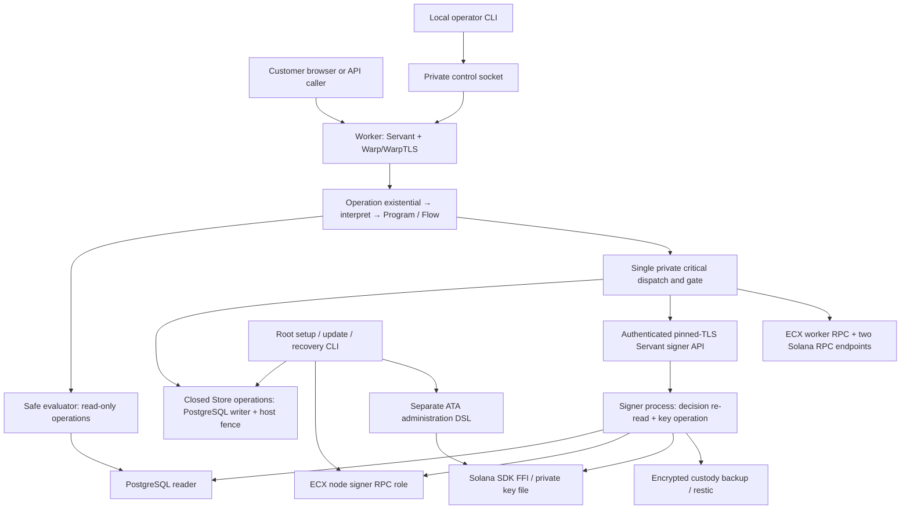

# Current architecture and line-by-line audit map

This is a static map for planning a later refactor, **not a refactor, test run or production approval**. Every first-party source, schema, test and authored build file in the snapshot was read in full. The coverage index identifies each file, its exact hash and read ranges, meaningful internal spans, effects and review limitations. Historical documentation and dependency notices were classified rather than exhaustively re-audited.

- Repository: [freewillydev/hot-wallet-server](https://github.com/freewillydev/hot-wallet-server), branch `main`.
- Base commit: `a485cac557a63395ebb6ef294836e9b9113ff707`; audit date: 2026-10-25.
- Scope: **181 tracked input files**, including the actual uncommitted `src/src/Bridge/Operation/Internal.hs` bytes. Generated outputs, ignored private state, other branches, other repositories and installed dependency implementations are outside the source audit.
- Coverage: [architecture-lines.tsv](.audit/architecture-lines.tsv). Its `kind`, `status` and `limitations` distinguish full source reads from fixtures, lock inventories, reference material and contextual documents. The input inventory predates this map and its new audit receipts.
- Method: parent plus three read-only reviewers partitioned the files, read all assigned physical lines and reported semantic ranges. `StoreCheck.hs` was split into contiguous 1–1900 / 1901–3900 / 3901–5982 sections. Counts include blank and comment lines; nonblank counts are also recorded. No build, test, service, deployment, RPC or financial operation was executed for this audit.

## Cross-audit reconciliation (2026-10-25)

The subsequent [refactor design](REFACTOR-DESIGN.md#grok-build-and-claude-conclusions-reconciled-2026-10-25)
incorporates the conclusions of the Grok Build CLI audit and matching Claude Code
audit. Their local maps remain separately authored and unmodified. This source
inventory and its frozen counts remain unchanged; the following clarifications
are evidence updates, not application changes:

- Claude's historical compiler logs establish draft failure and archived-source
  success for **lib:workflow only**. They do not establish a full executable or
  test-suite pass. No compiler was run in this reconciliation.
- Grok's approximately 21.4k production figure excludes the 294 inline Rust test
  lines included in our 21,725 runtime/setup subtotal. The whole authored count
  is still 37,510. SQL has 98 function definitions and 106 triggers; Control has
  21 operator commands. Constructor-name occurrences are not all pattern matches.
- Move explicit database mode coverage before structural cuts. The documented
  recipe omitted and did not clear the early-exit gas selector; its eighteen-mode
  correction is documentation only and was not executed. Provisioning remains a
  separate case. The design budgets a future one-command runner.
- Add named private CriticalEnvironment fields. Preserve nested checked grammar,
  observation restrictions, exception scopes and the sole runtime critical gate.
- Memo-bound deposits are unreachable for new orders but remain reachable through
  saved bindings/refunds. Duplicate helpers may have test/export consumers; no
  broad dead-code deletion is justified by the other maps' labels alone.
- Weekly 10%-of-supply unwrapping and multisig in reference/Main.hs are absent,
  unresolved historical requirements. Seeds alone do not restore liabilities or
  signed-attempt history. Current protected restore remains necessary.
- Main's wrapper and the separately developed sidechain branch must be inventoried
  distinctly before a merged-product refactor. This map does not cover that branch.

The later [DeepSeek reconciliation](REFACTOR-DESIGN.md#deepseek-conclusions-reconciled-2026-10-25)
adds targeted corrections without changing this inventory. Its final transcript
admits substantial unfinished reads; it is partial evidence. The signer uses RPC
and backup networking, root setup handles private keys/database provisioning, and
`ecxbridger` is a database role. Workflow construction remains after Refl in
Operation/Internal. InstallConfig's parser is 81 of its 279 lines; rotation and
configuration publication are different protocols; some alleged duplicate Store
mappings are aliases, existing derived selections or distinct views. Keep the
current costed +177-line forecast, rather than DeepSeek's repeated older +30.
The new authority table and adopt/defer/reject decisions are planning only.

## 1. Baseline coherence comes before refactoring

The local operation grammar is **not the same source as the committed version used by earlier passing checks**. Its SHA-256 is `32d6f2fe05b1fbd98a5de056f0444adc9e37aa6c414e60ec2879c2f3aca1669f`. It is preserved unchanged.

The 459-line local `Operation/Internal.hs` omits `CustodySteps`, `RetrySteps`, `CancellationSteps`, `OwnerFeeSteps`, evidence families such as `RetryWork`, `CancellationWork`, `CancellationCommit` and `OwnerFeeWork`, and `RetryWorkflow`, `CancellationWorkflow` and `OwnerFeesWorkflow`. `Critical.hs:515–639,1046–1097` and `test/Main.hs:330–468` still refer to that design. Its changed resume/native capability methods also do not align with their implementations. These are concrete static inconsistencies; this audit did not run the compiler. A historical receipt that explicitly substituted the committed Operation file does not establish that this working tree builds.

The map therefore describes **the current working source**, and identifies intended-but-disconnected paths where the grammar draft and its consumers disagree. The first future implementation task is to reconcile that draft without silently discarding it, establish one compiling baseline and run the applicable positive and negative checks. Do not start a line-count reduction from mixed versions.

The supplied [reference/Main.hs](reference/Main.hs) was read in full and remains unmodified, outside production builds. It explains the requested severity/typeclass/existential/GADT direction, but is an incomplete sketch rather than a correctness proof. The public `operation-capabilities` dependency is pinned in the Cabal configuration; this audit reads its use, not all of that separate library's implementation.

## 2. Exact size and scope

**116 first-party code/test/build/config files: 37,510 physical lines, 36,039 nonblank.**

| Layer | Files | Physical lines | Architectural role |
|---|---:|---:|---|
| Core: `src/src` | 7 | 2,021 | Money, identities, wire records, lifecycle decisions, operation grammar |
| Workflow: `src/workflow` | 12 | 2,905 | Evaluators, capabilities, order/observation/payment orchestration, transports |
| Database/runtime: `src/runtime` | 7 | 5,651 | Closed ledger operations, projections, provisioning, backup and host fencing |
| Customer API: `src/api` | 1 | 25 | Four Servant routes and pure request packaging |
| Chain boundary: `src/chain` | 19 | 3,943 | ECX/Solana RPC, parsing, evidence, wallet/transaction/FFI mechanics |
| ATA administration: `src/administration` | 3 | 354 | One-time associated token-account preparation/signing/submission |
| Application/setup: `src/app` | 16 | 4,390 | CLI, config import, installation, updates, wallet rotation and restore |
| Browser: `src/web` | 4 | 879 | Haskell-to-JavaScript interface, HTML and CSS |
| Solana Rust helper | 1 | 584 | SDK codec/signing/FFI plus inline tests |
| C curve shim | 1 | 37 | libsecp256k1 calls |
| PostgreSQL schema | 1 | 936 | Durable relational integrity and financial transition constraints |
| **Runtime/setup source subtotal** | **72** | **21,725** | Includes the Rust inline test section |
| Test/formal files: `src/test` | 14 | 13,056 | Properties, contracts, fixtures' consumers and TLA+ model |
| Authored build files + `example.conf` | 30 | 2,729 | Cabal/hooks, installer/release scripts, restic patch, configuration example |
| **Total** | **116** | **37,510** | Excludes data fixtures, locks, docs and third-party notices |

The Rust file's `#[cfg(test)]` section is lines 291–584 (294 lines); its deployed helper portion is lines 1–289, with a separator at 290. Moving those tests between buckets would change presentation, not the repository total. Haskell alone accounts for **80 files / 32,877 physical lines**. Nine JSON data fixtures contain 754 lines; the BIP39 word list contains 2,048 entries. Those are separately inventoried rather than counted as authored executable logic. The 118-line architectural reference and retained 601-line upstream Python copyright utility were also read, outside the first-party total.

Largest files: `StoreCheck.hs` 5,982; `Store.hs` 3,990; `Critical.hs` 1,260; `ConfigureCheck.hs` 1,214; `ChainCheck.hs` 1,195; `LifecycleCheck.hs` 1,156; `Lifecycle.hs` 1,039; `schema.sql` 936. The browser is a small share. The ledger, setup/recovery and their contract tests dominate.

The language footprint is Haskell, SQL, HTML/CSS, shell, a Rust SDK behind FFI and a C shim. Extensionless build programs also include Python; a retained Go patch belongs to the restic dependency build. There is no separate hand-authored application JavaScript file, but Haskell browser code contains JavaScript FFI snippets and produces generated JavaScript. “Built through Cabal” does not mean only one underlying compiler or runtime dependency.

## 3. Product boundaries and deployment map

The current main checkout implements an **inventory-backed ECX ↔ wrapped-ECX exchange**. It transfers held wrapped tokens on Solana; it does not mint them on customer deposits or burn them on redemption. The administration component creates the bridge's associated token account (ATA), not the token mint. Standalone mint/metadata/pool tools belong to the other repository.

`Direction` contains `NativeToWrapped` and `WrappedToNative`. This audited checkout contains no integrated Thunder/BitNames sidechain fast-withdrawal customer operation or enforcer adapter. Historical requests and another branch's functionality must not be attributed to this main snapshot. Supported profiles distinguish ECX Signet/Solana Devnet and canonical betanet/Mainnet; profile code is not evidence of live acceptance.

Current behavior includes saved quotes and capability-authorized order recovery; unique native deposit allocations or Solana reference association; 1% wrapping/unwrapping fees; confirmation/finality checks; configurable customer payout rounds; refunds bypassing those rounds; optional fixed SOL gas top-ups on wrapping; inventory/operating/earned-fee accounting; owner fee withdrawals; observations, custody reconciliation, backup, retry/replacement/source-loss recovery; and install/config/update/rotation/restore tools. The record installer requires the 100-bps fee values despite exposing fee fields. Existing saved orders keep their original terms.

The public worker, signer and ECX node have separate OS users. PostgreSQL has separate writer/read roles and a setup owner role. The worker can send already signed bytes; the signer handles signing and custody-backup work rather than customer intake or ledger mutation. Root setup remains a more powerful trust boundary. Optional Cloudflare ingress and a local monitor are additional services. They do not replace application authorization or establish that external alerts were delivered.

The signer uses loopback HTTPS with authentication and certificate pinning. The local operator-control socket and native-wallet-backup socket still exist for other purposes. Calling those “remaining signer sockets” would conflate different channels. Process boundaries and file/RPC/DB permissions are part of the security design; type constraints alone do not enforce OS isolation.

## 4. Requests, capabilities, Flow and concrete effects

### Entry and dispatch

`src/api/Bridge/API.hs:9–25` defines four customer operations: configuration, order creation, order lookup and payment-instruction retrieval. Handlers construct a `Plan` from typed commands. The internal existential is evaluated before a concrete typed response is encoded as JSON; the HTTP wire response is not a serialized existential dictionary.

`Operation/Internal.hs` defines caller/severity-indexed commands, capability constraints, results, workflows and programs. `someOperationAt` from the pinned library packages the constrained operation. `interpret` uses type equality (`eqT` / `Refl`) before constructing the permitted program and qualified `F.do` workflow. Flow sequencing records what capabilities and result states compose. A type equality proof aligns types; it does not authenticate a person, prove unique runtime dictionaries or establish financial validity.

`Critical.hs:192–445` owns process wiring, dispatch, concrete environments and evaluation. There is one lexical call to `evalCritical` in `runProcess` (line 247), behind the process's gate. The gate serializes whole critical workflows within that process. Private `evalWorkerRequest` and `evaluateSigning` evaluate nested authorized work while the gate is already held; they must remain private and must not recursively acquire the non-reentrant gate. Each process has its own gate, not one shared cross-process lock.

Safe evaluation still performs effects such as read-only database IO and logging. “Safe” means restricted authority, not Haskell purity. Concrete worker/operator capability instances perform the permitted leaf IO; their orchestration is expressed through the operation grammar and Flow. The grammar draft's missing classes/constructors currently disconnect several of these consumers.

### Signer paths and output identity

| Signer route | Intended operation/result family | Concrete effect boundary |
|---|---|---|
| `/sign-preparation` | Preparation signing result | Re-read saved decision, sign bounded exact draft, verify and re-read before release |
| `/draft-replacement` | Native replacement preparation result | Authorized native fee-bump draft and input/template validation |
| `/sign-replacement` | Native replacement signing result | Authorized saved replacement signing and validation |
| `/checkpoint-custody` | Custody checkpoint result | Consistent ledger/native/key archive, encrypted upload and readback receipt |

`Result severity op` uses distinct data-family constructors to avoid interchangeable output shapes. `Evaluation severity` instead carries concrete evaluator environments; it is not the signed-result family. The TLA+ model covers an abstract bounded set of route/gate/result transitions. It does **not** prove that all Haskell paths refine that model or cover setup, database state, cryptography, chain behavior and crashes. Trace logs help correlate a chosen path with that model; a returned/done log is not proof of settlement.

`Operation.Internal` is listed as an exposed Cabal module. The name “Internal” is not by itself an enforced module boundary. Audit package exports, constructor exports, concrete capability instances and evaluator visibility together.

### Separate privileged paths

The runtime gate is not the sole signing path in the entire repository. `src/administration/Token/Operation.hs` has an ATA-specific request/DSL; `Token/Network.hs:74–121,160–191` prepares/signs and submits that setup transaction. Native wallet import, encryption, recovery and backup operations also exist under setup/admin authority. Root install/update/restore filesystem and SQL administration do not run through the customer runtime gate. These are explicit scoped exceptions, not evidence that a public handler can invoke them.

`Bridge.RPC` is a chain JSON-RPC transport, not the signer client. It retries a classified allowlist of read operations, while mutation/unknown outcomes require explicit recovery. Pacing is scoped to a manager/host, not to all processes sharing a provider account. Different verifier hostnames do not alone prove independent providers or truthful observations.

## 5. End-to-end customer and payment path

| Phase | Code owners | Persistent contract / effects |
|---|---|---|
| Quote and order request | browser `Main`, API, Domain, Order, Admission | Exact amount/destination/fee/top-up terms; bearer capability and idempotency; reserve principal and operating capacity before exposing instructions |
| Native address or Solana reference | Identity, Native, SolanaDeposit, Order, Store | Native allocation label survives an uncertain reply; Solana receipt must bind a specific order/reference and source owner |
| Payment instructions | Order, Critical checkpoint, Store | Backup must cover the instruction's critical sequence; expired or unready orders do not expose usable instructions |
| Deposit observation | Observer, NativeObservation/NativeHistory, SolanaObservation, Store | Durable cursor/progress and immutable evidence; one observation posts source funds once; later observations change eligibility without reposting |
| Eligibility and custody | Lifecycle, Reconciliation, Store | Native confirmation policy and Solana finalized evidence; exact inventory versus journal/in-flight correction; stale/contradictory evidence cannot authorize payout |
| Obligation and payout round | Lifecycle, Store | One immutable payment obligation; complete cohort membership under saved threshold/interval; refunds bypass batching |
| Preparation and draft | Critical capabilities, Payment, NativePayment/SolanaPayment, Store | Saved destination, principal, fee/rent/top-up budget, native inputs or Solana blockhash and generation |
| Backup and signing | Critical, Signer, Credentials, SDK/native signer role | Sign by saved preparation identity; separate signer validates saved authorization before and after signing |
| Attempt and broadcast intent | Payment, Store, Critical | Independently validate exact signed reply; save immutable bytes; durable intent and backup coverage before sending |
| Send and observation | Critical, RPC, PaymentObservation, chain verifiers | Submit exact saved bytes; an uncertain response does not authorize a new payment |
| Settlement and customer status | Store, Lifecycle, Web/browser | Principal settled once, exact fees/rent/top-up accounted, holds released; projection reports the durable state |

There are several state dimensions because they answer different questions: customer order status; payment root phase; deposit eligibility; preparation/attempt generation; custody revision; monotonic critical sequence; and remote backup coverage. Combining them into one status enum would lose information unless a replacement explicitly preserves their independent transitions.

Recovery paths include unsigned cancellation and native-input cleanup; Solana expiry proof before an explicit retry generation; bounded native replacement families and winner changes; source-loss/reappearance review and capital cover; verified treasury allocation/external spend; and same-byte rebroadcast of a previously booked effect. These are real functionality protecting uncertain outcomes and historical obligations. Some similar-looking checks deliberately exist both at preparation and immediately before the irreversible action.

## 6. Ledger, schema, purity and durability

The core has pure `Domain` amount/accounting functions, `Identity` commitments/payment references, `Wire` serialization, `Lifecycle` decisions over explicit facts, and `Operation` authority/flow descriptions. `Error` is an explicit exception boundary: `reject` and `require` throw in IO, so the core directory is not wholly effect-free. Opaleye table/query construction in Schema/Projection is pure syntax construction; executing it in Store is database IO. A Flow description is likewise distinct from its concrete effectful capability instances. Most external-world complexity belongs to `Critical`, `Store`, chain adapters and setup modules. `Wire` mixes customer, saved and internal evidence types; JSON-in-TEXT and repeated field extraction are readability seams for a future typed codec design.

`Store.hs` exposes opaque reader/writer handles and closed operation GADTs: **65 reads and 48 writes**, plus setup/restore/backup operations. Each application row read/write—including diagnostic/catalog projections and test fixtures—uses Opaleye within a specific interpreter. libpq connection/transaction control, fixed schema/role DDL and test fault-injection DDL are infrastructure exceptions. It would be inaccurate to say no SQL exists: `schema.sql` is an important executable layer.

The writer uses an in-process MVar, a PostgreSQL advisory ownership lock and a locked deployment row. Transactions use ReadCommitted with explicit serialization; sensitive facts are obtained under that boundary. Read operations use separate read-only RepeatableRead transactions. The production `withFencedWriter` composes the durable host fence; the exported `withWriter` also accepts a trusted checkpoint callback used by test harnesses. That constructor seam must not be confused with end-user DSL authority.

The critical sequence is written to the filesystem fence before SQL commit. An ambiguous failure can therefore leave the fence ahead and deliberately stop/reject the writer. Silently rolling the fence back would allow replay. The critical gate, database locks, file lock, custody revision and backup receipt solve different problems and cannot be deleted as duplicate “locking.”

`Store/Schema.hs` defines Opaleye descriptors, frequently as positional tuples and multiple projections of the same table. `Store/Projection.hs` derives state and candidate sets. `Store/Catalog.hs` expresses privilege checks and fixed PG built-ins. `Store/Provision.hs` creates roles/current schema and handles isolated retirement/restoration. `Store/Backup.hs` exports one consistent MVCC snapshot and invokes pg_dump/pg_restore and restic with protected manifests/files.

`schema.sql` has **44 tables, 6 views, 98 functions, 106 triggers (including 8 constraint triggers) and 18 explicit indexes**. These counts exclude implicit indexes created by PK/unique constraints. Tables preserve deployment/checkpoints, source receipts/evidence, orders/obligations, journal postings/holds, preparations/signed attempts, cohorts/rounds, recovery approvals and replacement history. Views and constraints tie these together. The detailed Store span index at the end maps these responsibilities back to exact code.

SQL guards enforce immutability, saved-policy coherence, exact payment/subject bindings, phase/lineage rules, monotonic clocks, complete rounds and custody invalidation. Haskell makes the operational decision and the DB constrains persisted states. Similar predicates are not automatically redundant; removing one layer needs a proof of equivalent enforcement at its boundary.

Twenty custody-revision functions have identical bodies and are a concrete consolidation candidate. In contrast, broad historical selections in `ReadSendSubject`, custody checking, quote expiry and native family loading warrant bounded typed-query review rather than deleting retained evidence. `hints`/compatibility residue requires reference and saved-history checks before removal.

Backup contains the ledger and relevant custody recovery material, not just wallet seeds. Restoring from only keys does not reproduce order terms, obligations, spent-input lineage, saved attempts or no-duplicate-payment decisions. An HTTPS URL proves a transport shape, not an independent physical backup. Restore verification, old-host exclusion and separate activation are distinct responsibilities.

## 7. Chain, key and browser boundaries

| Area | Files / important spans | Audit meaning |
|---|---|---|
| Native identity/key validation | NativeKey, Wallet, cbits/secp256k1 | Native addresses/xpub/curve checks; BIP39 and fixed derivation paths; passphrase/alternate-path recovery is not implied |
| Native privileged lifecycle | Native (`NativeRecovery` GADT) | Wallet creation/import/encryption, labelled allocation, protected backup/restore; broader authority than read-only chain queries |
| Native observation | NativeHistory, NativeObservation | Full response capture/hash before callbacks; bounded projections; complete/partial scan semantics and durable cursor |
| Native payment | NativePayment, PaymentSource, PaymentObservation | Exact outputs/prevouts/change/fees, owned input locks, bounded replacement family and stable conflict/absence evidence |
| Solana identity/history | Solana, SolanaObservation | Mint/account/network checks, two provider observations, resumable bounded progress; strict absence proof has different completeness requirements |
| Solana incoming receipt | SolanaDeposit | Read-only reference association, token effects and historical owner/refund proof; broad custody observation alone does not authorize a customer deposit |
| Solana outgoing transaction | SolanaMessage, SolanaPayment | Legacy binary parsing and independently checked message/signature/effects; saved fee/rent/gift/blockhash; simulation is not finality |
| FFI SDK | SolanaHelper, Token, `solana-helper/src/lib.rs` | Bounded versioned messages, dynamic library trust, private key-path handling, signing/encoding; no chain RPC inside Rust helper |
| Private files | File, AdminKey, Credentials and per-purpose setup helpers | Open-descriptor bounds, ownership/link/permission checks and durable publication differ by purpose; file helpers do not share one universal policy |
| Browser | web/Main, web/Browser, HTML/CSS; workflow/Web | Presentation, local saved-order capabilities, QR/copy/request flow; backend remains authoritative for amounts, references, status and authorization |

The outgoing strict legacy transaction decoder and broader incoming JSON parser handle different sets of acceptable data. Replacing them with one permissive generic decoder would weaken the boundary. Similarly, paginated regular observation and exhaustive expiry/absence proof are different algorithms for different claims.

The Rust key loader checks filesystem metadata and then reads; its parent directories must remain protected. Cryptographic key data can have copies whose erasure is not established by this source map. `bincode` is used here for typed serialization, not as a generic decoder of untrusted input, but this audit is not a fresh advisory scan of dependencies.

Frontend code does not require a connected website wallet. Solana Pay transfer requests and native wallet instructions still require actual wallet compatibility testing. Custody reserve checks, confirmation policy and replay handling remain on the server, regardless of a custom website. Customer capabilities in localStorage/URLs and a custom site's scripts form a browser trust boundary.

## 8. Setup, updates, wallet rotation and restore

The input record is read as data; shell never sources/evals it. `InstallConfig` normalizes syntax/old field forms and supplies secret-safe diagnostics before derived `Read` and semantic validation. It is not a general Haskell interpreter. The operator's `/root/hot-wallet/server.conf` is distinct from the protected accepted/pending copies under `/var/lib/hot-wallet-server` and role-specific runtime JSON files. These copies capture different accepted/pending/recovery states, not merely repeated preferences.

| Operation | Entry and phases | Important distinction |
|---|---|---|
| Source install | `install.sh` → protected input → `git archive HEAD` → non-root build → configure → node/history/backup qualification → wallet/ATA bootstrap → package/services → readiness | Installs committed HEAD, not a dirty working tree; first run can stop for config editing/funding |
| Config change | `update-config.sh` → new updater → immutable old/new journal → classify/preflight → custody stop/checkpoint → publish fixed files → validate/restart | Supported changes only; backup destination switch checkpoints the new repository before resuming |
| Signed runtime upgrade | `update.sh` → configured pre-staged release/key → `release-auth` → `.run update` → Upgrade interlocks/checkpoint/fence → same-schema install → paused verification/resume | Signature trust is separate from checksums; does not fetch an unspecified “latest” release |
| Wallet replacement | Validate new supplied identities → checkpoint/retire old ledger with no unresolved liabilities → preserve private old generation → import/rebind new generation | Both initialized wallet identities change; old balances are not automatically swept |
| Restore | Source exclusion/minimum sequence → verify bundle → role-specific ledger/native staging → started/completed journal → separate activation | An uncertain restore subprocess is not blindly rerun; old-host exclusion remains an operational fact |

`Configure` supplies simplified/advanced interactive entry and runtime setup records; `InstallConfig` supplies the record entry. Record setup validates supplied seeds/keys and does not generate missing wallets. Interactive startup is the separate generation path. `Bootstrap`, `NodeSetup` and `Menu` orchestrate provider/node/wallet/backup readiness. `Reconfigure`, `ReconfigureFiles` and `ReconfigureServices` classify and durably publish operational changes. `WalletRotation`/`RotationFiles`, `Upgrade` and `RestoreGuide`/`RestoreNative` own different interruption/recovery journals. The `InitializeSolanaOperating` Store operation accounts for actual initial SOL/ATA spending rather than silently crediting arbitrary capital.

Source config update and installed runtime release update are not interchangeable. The updater may be freshly built while installed services still refer to their prior release. Source-mode node helper selection uses the current compiled source location, while some package/restic selection still consults saved `sourceRoot`. These are concrete integration seams for later tests, not claims about a live host inspected here.

Runtime principals include `ecxbridgew` worker, `ecxbridges` signer, `ecxnode`, PostgreSQL and root administration. Build work uses a separate `hws-build` account. Optional cloudflared receives its token rather than custody keys. A root monitor checks local status/services/disk/certificates and an optional notification hook. A local report does not establish delivery to an external alert destination.

Managed launch/node setup currently targets Ubuntu 24.04 x86_64. Packaging/toolchain tables mentioning aarch64 do not establish an ARM64 clean-install path. The managed node defaults to a pinned chain snapshot and pruning, preserving existing chain data. A pinned snapshot is a trust input, not proof of replay from genesis. Download retry preserves bytes, verifies the final hash and uses separate extraction/promotion markers. That mechanism was read here, not rerun against the user's failed transfer.

The “one script” interface installs external prerequisites. Extensionless build tools include Python `release-auth` and `check-readfloat-sources`; shell orchestrates system packages, compilers and services. The restic security patch modifies Go dependency/toolchain metadata. Licenses, dependency locks and provenance data are not disposable merely because they do not execute customer transactions.

## 9. Verification architecture: what each kind can establish

| Evidence source | What its code checks | What it cannot establish alone |
|---|---|---|
| Domain/Lifecycle QuickCheck | Integer/accounting laws, phase decisions, batch capacity, generated histories and negative controls | Locked fact acquisition, real chain truth, current deployment |
| Flow trace carriers | Actual post-Refl sequencing, branch/failure prefixes, cancellation propagation | Concrete DB/HTTPS effects; currently blocked by draft mismatch |
| Negative compilation cases | Forbidden capability/caller/severity/state compositions | A normal positive compile is not the negative matrix; unrelated missing names can create false confidence |
| Chain recorded vectors | Exact known transaction layouts/effects, mutations and refusal behavior | Live wallet-app compatibility or a newly completed transfer |
| Local HTTP/TLS/filesystem tests | Actual Servant/Warp/TLS handling, permissions, locks, private file journals and subprocess behavior | Remote provider availability or production OS/service acceptance |
| `ecx-store-check` / ProvisionCheck | Actual disposable PostgreSQL constraints, atomicity, replay, backups, fencing and selected integrated workflows | All modes are not enabled by one invocation; some seed facts/direct Store calls bypass the end-user workflow |
| Explicit live/funded modes | When deliberately invoked, real profile-specific observation/recovery/transfer scenarios | Their source presence is not evidence they ran; funds/network access are mode-specific |
| TLA+ | Bounded abstract signer path/gate/output model | Haskell refinement, cryptographic security, ledger/RPC truth and crash correctness |
| Historical receipts | A named command/result on its identified source/artifacts | Current dirty-tree or current production approval |

`StoreCheck.hs` is a multi-mode integration executable, not a homogeneous randomized unit-test file. Some deterministic IO contracts are wrapped in QuickCheck with one run. Its environment selectors, protected disposable database checks, direct fixture seeding and explicit live modes need to remain visible. Independent accounting models must not be shortened by reusing the very production calculation they are intended to check.

The largest test file has these major sections; the coverage index gives the smaller spans:

| StoreCheck lines | Main responsibility | Actual evidence boundary when executed |
|---|---|---|
| 1–843 | Mode selection, dedicated live modes, credential/native/custody/archive setup, cache and initial ATA accounting | Explicit mode determines whether real chain reads occur; not all modes run together |
| 845–1906 | Writer/read-role/constraint tests, admission, lifecycle/source-loss, native paging and large totals | Real disposable PostgreSQL; many evidence rows intentionally seeded |
| 1908–2439 | Payout cohorts, owner limits, refund bypass, saved clocks, SOL gift accounting, rollback and competing writers | Real locking/deferred failures; synthetic receipts/attempts |
| 2441–3238 | Closed Fixture GADT and its Opaleye interpreter | Powerful test-only setup and corrupted-state probes; not a production DSL escape |
| 3240–3632 | Custody, dual providers, 10,001-entry history, native replacement-family corrections | Controlled RPC data plus real DB; captured vectors are not new funded runs |
| 3634–4165 | Lost allocation response, actual customer/control HTTP, backup deadlines, fence, offline server/restore | Real local processes, permissions, HTTPS and persisted state |
| 4167–4668 | Refunds, cancellation, expiry/retry, treasury/external spend | Saved invariant/replay contracts; chain truth injected for each case |
| 4672–5309 | Worker/signer HTTPS, authentication, gate serialization, read-again denial, checkpoint and exception scopes | Actual evaluator/transport paths with controlled chain service responses |
| 5311–5729 | Source return/cover, replacement winner changes and exact-byte rebroadcast | Real ledger transitions; explicitly synthetic native families/evidence |
| 5733–5982 | Exported DB snapshot, pg_dump/restore, encrypted restic roundtrip, paged-history CAS | Real local backup restoration; does not grant production off-host acceptance |

`tlsMain` (4672–5309) combines many independent invariants in one long harness. Several later contracts depend on records created by earlier contracts. Shared named fixture mechanics could improve diagnosis, but helpers that silently mark everything ready/backed-up would erase the negative cases. `historyProgressMain` intentionally retains a restored fixture database/archive for inspection; that is a cleanup concern when tests are run, not a service started by this audit.

Many test helpers duplicate private temporary directories, expected exceptions, JSON mutations, fixture loading and scenario setup. Those mechanics are candidates for consolidation. Independent expected values, real PostgreSQL constraints, failure injection at publication boundaries and no-duplicate-payment checks are not redundant simply because multiple suites touch a similar scenario.

## 10. Concrete future simplification map

This is a **candidate map, not an approved implementation plan or promised reduction budget**. Affected footprint is not net savings. Start from one coherent baseline, preserve behavior, and measure each replacement. Readability may require expanding compressed SQL/tuple expressions even while removing duplicate logic overall.

| Priority / candidate | Exact source territory | Why it may help | Required preservation/evidence |
|---|---|---|---|
| 0. Reconcile local grammar | Operation/Internal 54–115,157–316; Critical 515–639,1046–1097; test/Main 330–468 | Removes version ambiguity before measuring anything | Preserve draft; choose intended design; positive component build plus meaningful negative compile cases |
| 1. Shared typed configuration projections | InstallConfig 31–80,85–102,108–188,230–279; Configure 54–430,537–601; Reconfigure 223–322 | Repeated fields/defaults/JSON projections invite drift | Separate secret/public/role outputs; preserve old terms, original bytes, key-import policy and update classification |
| 2. Small durable-file mechanics | ReconfigureFiles 157–282; RotationFiles 205–255; Credentials 1–66; Recovery 155–187; Fence 43–108 | Repeated opened-fd checks, bounds, fsync and atomic publication | Keep each purpose's owner/group/link/parent policy; file replacement, directory retirement and unknown subprocess outcome remain different protocols |
| 3. Lifecycle transition structure | Upgrade 49–200; ReconfigureServices 46–207; WalletRotation 49–182; RestoreGuide 44–152 | Repeated stop/checkpoint/publish/verify machinery | Do not flatten different backup/rotation/restore orderings into arbitrary shell callbacks |
| 4. Concrete SQL duplication | schema.sql: custody bump bodies at 442,446,450,454,458,462,466,470,474,478,482,527,543,573,601,605,625,629,681,704 | **20 identical function bodies** can plausibly share one function; about **76 physical lines** including separators | Preserve all trigger attachments/timing/predicates; verify installed schema/restore compatibility and actual PG regressions |
| 5. Other immutable SQL guards | schema.sql 317–724 | Similar unconditional immutability functions may share explicit trigger arguments | Distinguish conditional checks, OLD/NEW returns, error contracts and deferred invariants; no blanket deletion |
| 6. Store fact/projection organization | Store 971–3990; Schema 90–336; Projection | 3,990-line interpreter interleaves fact loading, decisions and writes; tuple shapes recur | Closed GADTs, private connection access, locked facts, transaction scope and historical encoding; splitting files alone saves zero lines |
| 7. Bound historical queries | Store 1303–1327,2257–2306,2469–2543,3544–3598 | Broad selections then filtering make long-lived ledgers harder to reason about | Prove no skipped old obligations, loss evidence, replacement family or reorg history |
| 8. Explicit evidence codecs | Store 1482–1535,2406 onward; Payment/Reconciliation/chain decoders | Repeated `Value` field extraction and anonymous tuples obscure authoritative facts | Golden saved-JSON/work-hash compatibility; separate raw observation from validated evidence |
| 9. Clarify Critical responsibilities | Critical 192–445,457–513,531–1097 | Separate resource/transport mechanics from authorized leaves and pure flow | Keep one private dispatcher; private internal dispatch assumes gate already held; avoid recursive gate acquisition or exported IO escape hatches |
| 10. Common FFI mechanics | SolanaHelper 107–149; Token 107–121 | Bounded protocol/call/result handling is repeated | Preserve ATA-only versus customer-payment grammars, key-path access, size limits and independent Haskell byte validation |
| 11. Parsing versus acquisition | NativeObservation 27–139; SolanaPayment 39–257; Native 234–476 | Clear pure parsing and privileged IO boundaries aid independent review | Full capture before emit, saved labels/bytes, current evidence, exact failure semantics |
| 12. Test harness factoring | StoreCheck; ConfigureCheck; ChainCheck; smaller payment suites | Smaller named scenarios and shared mechanics make coverage/failures easier to inspect | Keep independent oracles, real PG/HTTP/FD/child-process boundaries, explicit opt-in live modes and all meaningful failure prefixes |
| 13. Presentation cleanup | web/Main; workflow/Web 203–228; web/style.css 139–145 | Repeated status/format terms and apparently unused selectors | Verify usage; keep backend authority, exact quote/reference checks and bearer-capability handling |
| 14. Proven-unused artifacts | Retained upstream copyright utility, historical feature documents, `hints` compatibility residue | May reduce navigation or maintenance burden | Establish references, retained schema/history and license obligations first; data/history removal is separate from code refactoring |

A 7k/4k goal is not supported by this audit as a no-functionality-loss promise. The runtime/setup source alone is 21,725 lines; installation, crash recovery, reconciliation, backup and update behavior are real functionality. Comparing that to a manual mint script measures different products. Removing interactive/advanced setup, owner accounting, backup, recovery or tests would change scope/assurance. Packing statements onto fewer lines would improve the count while worsening auditability.

### Guardrails for the later implementation pass

- Preserve exact accounting, historical quotes, source/refund ownership, durable idempotency and saved signed bytes.
- Preserve phase ownership: order status, payment phase, deposit eligibility, custody revision, critical sequence and backup coverage mean different things.
- Keep external observations outside SQL mutation transactions; obtain/recheck authorization-sensitive database facts under the existing locks.
- Keep all application row access in closed Opaleye operations. Do not replace verbose code with generic SQL/RPC/IO escape hatches.
- Keep setup signing, node-wallet operations and root lifecycle administration explicitly mapped; runtime type constraints do not cover them automatically.
- Treat line reduction as a measured result of a clearer design, with a before/after call/effect map and retained tests for each piece.

## 11. Navigation for auditors

The TSV has one row per original tracked file, not one row per discovered function. `read_ranges` means the complete physical range inspected; `spans` identifies meaningful groups inside it, including boilerplate that was read but does not merit an individual finding. `imports` is a lexical Haskell import index, useful for navigation but not a compiler-resolved call graph. `status=classified` means the file is inventoried but not represented as a full source audit.

Start with Domain → Lifecycle → API/Operation → Critical → Store/Schema → chain evidence parsers. Then trace setup/update/recovery separately through app and build files. Use the test rows to locate the independent checks for each transition. Review source hashes before reusing this map after changes.

For the large Store module, the following more detailed index keeps the financial boundaries visible:

| Lines | Responsibilities / effects / dependencies |
|---|---|
| 1–65 | Public opaque handles and closed API exports, pure view/policy records, dependencies |
| 67–82 | Five offline setup constructors; delegation to Provision |
| 84–146 | Eight restore/inspection/fence commands; isolated restore pauses and invalidates custody; row/advisory lock around adopt/retire |
| 148–173 | Two backup commands; local exported MVCC snapshot and upload after DB transaction closes |
| 175–240 | 65 closed read constructors: customer/readiness/observation/custody/recovery/signing facts |
| 241–289 | 48 closed write constructors: observations, instruction exposure, payment accounting, recovery, batching |
| 291–325 | Reader and Writer lifecycle; worker advisory lock; optional composed file fence; writer opens paused |
| 327–468 | Concrete read interpreter; credential role verification; repeatable-read; bounded public-report session timeout |
| 470–642 | Concrete write dispatcher; closed operation-specific mutations and validation; native claims, backup receipts, source/custody updates |
| 644–678 | Transaction serialization, deployment FOR UPDATE, critical fence before commit, poison uncertain connection |
| 680–721 | Identity/schema/sequence checks, custody freshness, historical cancellation quarantine, operator facts |
| 722–816 | Withdrawal projection and public accounting report; complete historical aggregates and original settlement event dating |
| 818–858 | Integer balances, balanced append-only posting helper, account/JSON decoding |
| 860–969 | Capability-authorized order view, payment pagination/status, saved-term decoding and idempotent lookup |
| 971–1023 | Atomic quote creation, saved terms/costs, inventory/operating admission and cohort assignment |
| 1025–1104 | Earned-fee reservation and automatic owner amount; holds, balance movement, idempotent replay |
| 1106–1194 | Complete payout liability projections, closing capacity, cancellation capacity, immutable cohort policy |
| 1196–1233 | Intake/scanner facts and immutable cost reservation encoding |
| 1235–1301 | Authorized native allocation claim and Solana reference binding; persistent instructions, backup-gated exposure |
| 1303–1332 | Expiry of unused quote holds, audit insert helper |
| 1334–1420 | Eligible deposit promotion into one immutable conversion obligation and payment root; wrong/late review |
| 1422–1480 | Source evidence decoding/checks; pure source decision, journal deficit/return, paused recovery |
| 1482–1535 | Stable recovery work-hash preimages over obligation/preparation/attempt/cancellation/fee/replacement history |
| 1537–1586 | Resumable history scan progress encoded as reserved checkpoint rows; cursor compatibility |
| 1588–1651 | First deposit observation posts money once; later changes eligibility/anchor/depth without reposting; loss binds work hash |
| 1653–1755 | Scan health/failure handling and complete/partial observation transaction; immutable evidence plus sticky review, cursor checks |
| 1757–1823 | Conflicted native transaction invalidates every paged outpoint; instruction/ref lookup, pending verification and historical depth |
| 1825–1947 | Reconstruct immutable funding, authoritative payment root and legal phase; monotonic operating time and daily budget |
| 1949–2081 | Preparation loading/admission and generation decision; pure Lifecycle fact model; saved budget and closing holds |
| 2083–2188 | Once-only draft, exact attempt recording, backup/readiness-gated signer decision; no signing implementation |
| 2190–2324 | Active payment queue, exact source authorization, current send context, durable broadcast intent and authorization |
| 2326–2404 | Final settlement/failure decision; principal once, fees/rent/top-up accounting, idempotency; read-model repair validation |
| 2406–2467 | Source binding, custody revision/scan heads and current chain event evidence |
| 2469–2589 | Complete custody snapshot with terminal-history revalidation; CAS reconciliation report and bounded pending attempts |
| 2591–2658 | One active payment per destination chain; complete batch rounds by asset; refund bypass, immutable membership |
| 2660–2703 | Native input-lock work projection and principal/operating held balance calculations |
| 2705–2761 | Atomic paused-ledger resume after exact saved-attempt/native-template review, no unresolved work/deficit/holds |
| 2763–2859 | Refund authorization from verified source owner and saved contract; closes prior unsigned work and preserves reserves |
| 2861–2964 | Exact cancellation begin/finish, no-signed-draft rule; bounded contiguous successor generations |
| 2966–3061 | Solana expiry/retry evidence and origin binding; separate proved expiry and explicit retry approval |
| 3063–3167 | Treasury allocation of unbound observed receipts; ownership attestation cannot supply amount; paged native commitment verification |
| 3169–3279 | Idempotent initial SOL/ATA operating accounting before any customer activity; exact observed funding and outflow, transactional rollback |
| 3281–3336 | Observed operator spend classification, never signing authority; reject customer attempt, hold-aware allocation and exact replay |
| 3338–3439 | Source approval binds latest restoration, prior reviewed work hash and optional exact cover/custody view |
| 3440–3540 | Paged native source recovery, source-loss cover from unreserved capital/earned fees, independent evidence/custody-view binding |
| 3542–3598 | Bounded native replacement family, saved policy/draft/input validation, lineage, prior-winner evidence |
| 3600–3701 | Idempotent replacement draft decisions, paused/readiness checks and unsigned cancellation |
| 3703–3774 | Exact replacement signer authorization and signature result persistence, no new payment/funding |
| 3776–3812 | Opaleye JSON projections filter unchanged settlements before recovery backlog bound; fixed casts, no caller SQL |
| 3814–3920 | Native settlement review/reconfirmation/winner change; preserve financial finality, only fee delta changes |
| 3922–3990 | Proved same-byte rebroadcast approval for a booked native effect; no new input/principal reopening |
